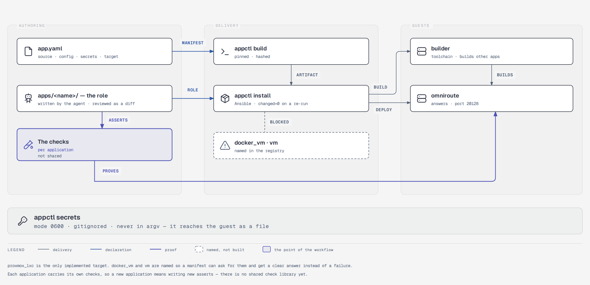
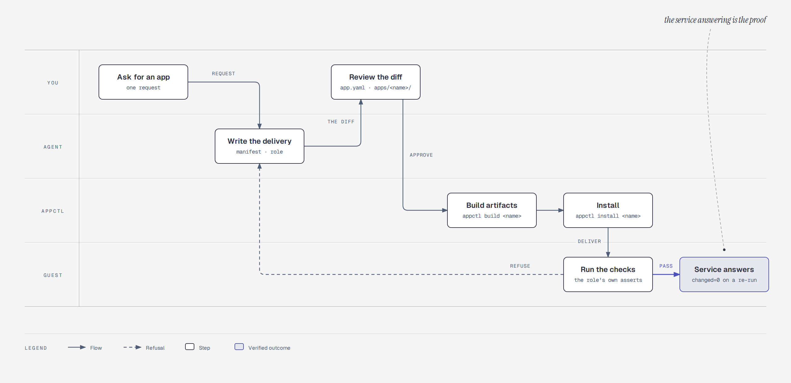
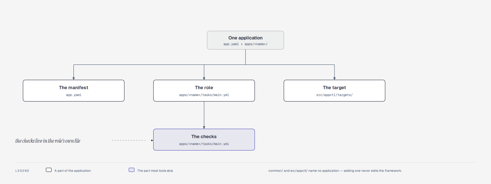

<p align="center">
  
</p>

<p align="center">
  <a href="#the-problem-it-solves">The problem it solves</a> ·
  <a href="#try-it">Try it</a> ·
  <a href="#how-it-works">How it works</a> ·
  <a href="#three-kinds-of-application">Three kinds of application</a> ·
  <a href="#ready-to-use-applications">Ready-to-use applications</a> ·
  <a href="#features">Features</a> ·
  <a href="#glossary">Glossary</a> ·
  <a href="#requirements">Requirements</a> ·
  <a href="#documentation">Documentation</a>
</p>

# DeployFlow

**Point your coding agent at this repository and tell it to install an
application. It writes the deployment, you review it, and the service is
verified before anyone calls it done.**

<p align="center">
  
</p>

<p align="center"><sub>
The current landscape. <a href="docs/diagrams/deployflow-current-state.html">Open the diagram</a>.
</sub></p>

DeployFlow is a workflow for delivering applications to servers. It defines
what an application needs, how it should be installed, and how we know it
actually works. The agent does the writing. The workflow does the proving.

The current implementation delivers to a container on a Proxmox host with
Ansible. That is the first destination, not the definition of the project.
The workflow itself — manifest, roles, checks, verification — is what
transfers when the next destination arrives.

## The problem it solves

An agent can write a deployment in a few minutes. What it cannot do, on its
own, is tell you the deployment is *correct*:

- The playbook finished green. That proves Ansible ran, not that the service
  works. A database file exists on a server that was never bootstrapped, and a
  process binds the wrong port — both produce a green play.
- The same steps run on every machine, and the differences between machines
  are where deployments break.
- The knowledge of "how this application should be installed" lives in
  someone's head, and leaves when they do.
- The next person, or the next agent, starts from nothing.

DeployFlow turns that into a repository an agent can work inside:

| | |
|---|---|
| **The application declares itself** | A manifest says where it comes from, what it needs, and what "working" means for it. |
| **The agent writes the delivery** | A role per application, generated against a documented contract, reviewable before it runs. |
| **The workflow proves it works** | Each application carries its own checks, and they run after every install. |
| **The steps are repeatable** | A second install on the same inputs changes nothing, and says so. |
| **The knowledge is in the repo** | The next agent reads it instead of guessing. |

## Try it

Four steps. The first two are the setup every run needs; the third is the one
that proves the workflow works; the fourth is how you add your own
application.

### 1. Get the tool

```bash
git clone https://github.com/bruj0/deployflow.git
cd deployflow
uv tool install --editable .
```

`appctl` is the command this repository is built around. It needs Python 3.12
or later, and it needs `ansible-playbook` on your `PATH`:

```bash
uv tool install ansible-core     # or: pipx install ansible-core
```

The manifest is gitignored too — `app.yaml` is yours, and the committed
template is [`app.example.yaml`](app.example.yaml). Copy it:

```bash
cp app.example.yaml app.yaml
```

### 2. Create your inventory

The inventory names your Proxmox host, your guest IDs and the addresses of
machines only you can reach. It is **gitignored**, so a fresh clone has none —
and that is the expected state, not a broken checkout. The committed templates
are in `inventory.example/`:

```bash
mkdir -p inventory/group_vars
cp inventory.example/hosts.yml inventory/hosts.yml
cp -r inventory.example/group_vars/. inventory/group_vars/
```

Then edit the two files the templates name:

| File | What to put in it |
|---|---|
| `inventory/hosts.yml` | your Proxmox host and your guests |
| `inventory/group_vars/all/main.yml` | your SSH public key |

### 3. Install an application and watch it prove itself

The repository ships `example-app`: a small HTTP service that installs from a
pinned wheel and checks that it answers. It needs no build host and no
half-hour compile, so it is the fastest way to see the whole workflow.

```bash
appctl install example-app
```

The last lines are the point of the whole exercise:

```
example-app: proxmox_lxc -> example-app  10 changed, 0 failed, 41 tasks, 33s
  check: example-app is installed and answering on port 8080
  check: import example_app: ok
  check: unit example-app: active
  check: listener on 8080: present
  check: endpoint /: HTTP 200
```

Those five lines are the application's own checks, not a task count. Each one
stands in for a failure that a green play would otherwise hide.

Now run it again:

```bash
appctl install example-app
```

```
example-app: proxmox_lxc -> example-app  0 changed, 0 failed, 41 tasks, 29s
  check: example-app is installed and answering on port 8080
  check: import example_app: ok
  check: unit example-app: active
  check: listener on 8080: present
  check: endpoint /: HTTP 200
```

**`0 changed` is the claim this project makes.** The second run found nothing
to do and re-verified the service anyway. A tool that reports a change every
run is reinstalling itself and proving nothing.

### 4. Add your own application

Do not write the role by hand. There is a skill for it, and your agent can
follow it:

> Read AGENTS.md and .agents/skills/deployflow-add-app/SKILL.md, then add support for
> <your application>. Use the deployflow-add-app skill. Show me the diff before you run
> anything.

The skill covers the manifest, the role, the pinned lockfile, the checks, and
the traps that make a run reinstall itself forever. It also documents how to
create the inventory above when it is missing.

To look around first:

```bash
appctl targets      # which destinations exist, and which are not built yet
appctl list         # what this repository has configured
```

### The other three applications

`example-app` is the smallest thing that works. Three others ship as worked
examples of the shapes that are harder:

| Application | What it shows | What it costs |
|---|---|---|
| [`omniroute-release`](apps/omniroute-release/) | an application installed from a **published release** | five generated secrets, no build |
| [`omniroute`](apps/omniroute/) | an application **built from a checkout** | a checkout, a build host, ~28 min |
| [`builder`](apps/builder/) | the **build host** the second one needs | 24 GB of RAM on the host |

`omniroute-release` is the one to run next if you want a real service: it
needs no builder and no compile.

## How it works

<p align="center">
  
</p>

<p align="center"><sub>
The workflow, lane by lane. <a href="docs/diagrams/deployflow-workflow.html">Open the diagram</a>.
</sub></p>

```
you:  "install a new application"
agent: reads the contract, writes the manifest and the role,
       runs the checks, reports what it changed and what it verified
you:   reviews the diff, approves the run
run:   installs the pinned artifact, then checks the service actually answers
```

Five parts:

<p align="center">
  
</p>

<p align="center"><sub>
Where each part lives. <a href="docs/diagrams/deployflow-anatomy.html">Open the diagram</a>.
</sub></p>

### 1. The manifest

What an application is: where its code comes from, what configuration it takes,
which secrets it needs, and which destination runs it. One file, `app.yaml`:

```yaml
applications:
  myapp:
    description: what it is, in one line
    target:
      kind: proxmox_lxc        # the destination that runs it
      options:
        hostname: myapp
        vmid: 121
    source:
      kind: repo               # a checkout, built here
      repo: /path/to/myapp
      ref: HEAD
    build:
      python_version: "3.14"
      verify_lock: true        # refuse a lock entry with no hash
    config:
      target: "{{ app_state_dir }}/config.json"
      files:
        - apps/myapp/config.yml
      vars:
        app_port: 9000
    secrets:
      - myapp_api_key
```

The `source:` block says where the code comes from. There are three kinds,
because there are three genuinely different things to say:

| Kind | What it is | What has to happen first |
|---|---|---|
| `package` | a published version | nothing — the artifact already exists |
| `repo` | a commit in a checkout | the artifact has to be built |
| `toolchain` | nothing at all — the application *is* the environment | the role assembles it |

The third is the unusual one, and it is what makes the workflow general
enough to build the other two. It is explained in
[Three kinds of application](#three-kinds-of-application).

`source.package` is the pin the operator reviews, and the role checks that it
installs the same thing. If the manifest says `bottle==0.13.3` and the role
pins a different version, the install refuses to run rather than quietly
installing something else. The application's *name* is not its package name:
`example-app` is what the guest calls the service, `bottle` is what gets
installed to serve it.

### 2. The application role

How it is installed, in one directory per application. The agent writes this;
it follows the contract in `AGENTS.md`:

```yaml
# apps/myapp/tasks/main.yml
- name: Copy the lockfile to the guest
  # pip on the guest cannot open a path on the controller, so the file
  # travels first and pip is pointed at where it landed.
  ansible.builtin.copy:
    src: "{{ role_path }}/files/requirements.lock"
    dest: "{{ app_dir }}/requirements.lock"
    mode: "0644"

- name: Install the application
  ansible.builtin.pip:
    requirements: "{{ app_dir }}/requirements.lock"
    virtualenv: "{{ app_venv }}"
    extra_args: "--require-hashes"

- name: Check that the application answers a request
  ansible.builtin.uri:
    url: "http://127.0.0.1:{{ app_port }}/"
  register: app_endpoint
  failed_when: false

- name: Fail when the application does not answer
  ansible.builtin.fail:
    msg: "The service listens but does not answer"
  when: app_endpoint.status is undefined

- name: Report the checks that passed
  # This task is what the summary prints. Its lines become the `check:` lines
  # the operator reads, so the evidence the application gave is the evidence
  # that is reported.
  ansible.builtin.debug:
    msg:
      - "{{ app_name }} is installed and answering on port {{ app_port }}"
      - "endpoint /: HTTP {{ app_endpoint.status }}"
```

### 3. The target

Where it runs. The manifest names one, and the target owns everything about
that destination:

```python
# src/appctl/targets/proxmox_lxc.py
@register
class ProxmoxLxcTarget(Target):
    kind = "proxmox_lxc"
    summary = "an application installed into a Proxmox LXC guest with Ansible"

    def validate(self, context):
        """Reject a bad setup before anything is built or started."""
        if not context.app().target.options.get("hostname"):
            raise TargetError("target is missing: hostname")

    def deploy(self, context, artifacts, rendered):
        """Install it, run its checks, and report what was observed."""
        ...
```

Two more destinations are named so a manifest can ask for them and get a clear
answer, but they are not built yet:

```console
$ appctl targets
implemented targets:
  proxmox_lxc: an application installed into a Proxmox LXC guest with Ansible
planned, not implemented:
  docker_vm: provision a virtual machine and run the application in Docker there
  vm: provision a virtual machine and install the application into it
```

### 4. The checks

The part most tools skip. A deployment is not done when the command succeeds.
It is done when the service answers. Each application carries its own checks,
because only the application knows what "working" means for it:

```yaml
# apps/myapp/tasks/main.yml
- name: Check that the package imports
  ansible.builtin.command:
    argv: ["{{ app_venv }}/bin/python", "-c", "import myapp"]
  changed_when: false

- name: Check that the service is listening on the requested port
  ansible.builtin.command:
    argv: [ss, -ltn]
  changed_when: false
  register: app_listeners

- name: Fail when the service is not listening on the requested port
  ansible.builtin.fail:
    msg: "The service is running but not listening on port {{ app_port }}"
  when: app_port | string not in app_listeners.stdout
```

The port check matters more than it looks. `systemctl is-active` says the
process is up; it does not say the process bound the port you asked for. A
service that came up on 8000 instead of 9000 passes an is-active check and
fails every request.

### 5. Secrets

`appctl secrets` manages a single file: `.env` at the repository root, mode
0600, gitignored. It is the only plain-text copy of a secret on the controller.

```bash
appctl secrets init                       # write .env (0600) and .env.example
appctl secrets check                      # what is required and still missing
appctl secrets list                       # names and state, never values
```

`init` reads the `secrets:` blocks in `app.yaml` and creates one key per
secret, empty, so a fresh clone knows exactly what to fill in. `.env.example`
— the list of required keys with no values — is committed, so the next person
sees what the deployment needs without seeing anything it should not.

Setting a value has three forms, and the first is the one to reach for:

```bash
appctl secrets set myapp_api_key                   # prompts; the value never reaches argv or shell history
appctl secrets set myapp_api_key '<value>'         # positional
appctl secrets set myapp_api_key --generate        # random value, 32 bytes of entropy
```

`--generate` takes several names at once, which is how the shipped
applications are set up — all five OmniRoute credentials are issued by the
system itself:

```bash
appctl secrets set omniroute_jwt_secret omniroute_api_key_secret \
                     omniroute_storage_encryption_key \
                     omniroute_initial_password omniroute_ws_bridge_secret \
                     --generate
```

`set` rewrites the file in place, preserving existing keys and their order, so
running it twice for one key leaves one entry — a duplicate `KEY` in a `.env`
is a well-known source of "I changed it and nothing happened".

Use `--generate` for a secret this system issues for itself. It is wrong for
anything with an external issuer: a provider API key has to come from the
provider, not from a random string.

`check` exits 1 while anything required is unset, which is what makes it
usable in CI. `appctl install` runs the same check before it touches the
cluster, because discovering a missing secret halfway through a play leaves
half the guest configured.

| Where | State |
|---|---|
| `.env` on the controller | the only plain-text copy, mode 0600, gitignored |
| the temporary extra-vars file | mode 0600, passed as `--extra-vars @file`, deleted at exit |
| the guest's `EnvironmentFile` | mode 0640, owned by `root:<service account>` — systemd reads it as PID 1, and the service account has to be able to read it too |
| the application's memory | resolved from that file at startup |
| **any log** | **never** |

A secret is never written to `app.yaml`, to a rendered config file, or to a
log. In a config file it appears only as a `${NAME}` reference, which the
guest resolves at startup — that is what makes a config file safe to commit.

Full detail, including the three ways a secret leaks and the guard for each:
[docs/secrets.md](docs/secrets.md).

## Three kinds of application

Most applications come from somewhere: a registry, or a checkout. Some
applications *are* somewhere — they are the machine other applications are
built on, and they install nothing at all.

That is the third kind, and the workflow needs it to describe its own build
hosts honestly:

```yaml
builder:
  description: the guest other applications are built on
  target:
    kind: proxmox_lxc
    options:
      hostname: builder
      vmid: 123
  source:
    kind: toolchain          # no package, no repo, no build
  secrets: []
```

A toolchain application:

- **installs no service** and publishes no port;
- **has no artifact**, so `appctl build` on it says so and exits non-zero
  rather than silently succeeding;
- **has no dependency on `common/python`** — that dependency is what asserts
  `app_port` is defined, and a build host serves nothing;
- **asserts the machine, not the install.** Its role checks that the guest is
  the right architecture, that the runtime is the pinned one, that it has
  enough memory and disk, and that it can reach the package registry. A role
  that installs a compiler and reports success has not said anything about
  whether a build can run on it.

That last point is the difference that matters, and it is measured. A builder
created with 12 GB of RAM passed every install check and then failed during
a build, with an error that named a memory limit and not the guest — and the
guest stopped answering SSH entirely. The role now asserts the floor it needs
before the build starts.

The worked example is [`apps/builder/`](apps/builder/).

## Ready-to-use applications

The repository ships four applications that work, not three that illustrate.
`example-app` is covered in [Try it](#try-it) above; the other three cover
the shapes that are harder.

### `omniroute-release` — an application installed from a published release

[OmniRoute](https://github.com/cheaper-inference/OmniRoute) is a Next.js
server with a native SQLite binding, served by one systemd unit on one guest.

This one is installed from a **published npm release**: the guest's own
`npm install` fetches a pinned version, and nothing OmniRoute-related runs on
the controller. It is the shape an application takes when its code already
ships as an artifact.

```bash
appctl install omniroute-release
appctl install omniroute-release        # must report changed=0
```

See [`apps/omniroute-release/`](apps/omniroute-release/) for what the role
asserts and why the credentials file is group-readable.

### `omniroute` — an application built from a source checkout

The same application, built from the upstream `main` branch instead of
installed from npm. It is the shape an application takes when there is no
published artifact — a fork, a development branch — and the build has to
happen on a guest of its own.

### `builder` — the build host

The guest the OmniRoute build runs on. It installs a compiler, a pinned Node
and a workspace, and it installs no service of its own.

```bash
appctl install builder
```

It publishes its address to `tmp/builders/builder.endpoint`, because guest
hostnames do not resolve from the controller — Proxmox's resolver is not the
controller's — and a build script that cannot find the machine cannot use it.

See [`apps/builder/`](apps/builder/).

## What you get when the agent does it

A reviewer reading the diff sees the intent, not a wall of generated YAML:

- the manifest block for the new application,
- one role directory with the install steps and the checks,
- a pinned dependency lockfile, so the tree that installs is the tree that was
  reviewed,
- a recorded `state:` block saying what was built and when it was last
  installed.

The agent's own reasoning stays in its session. What lands in the repository is
declarative and reviewable.

## Features

Every feature, what it gives you, and the file that holds it.

| Feature | What it gives you | Where |
|---|---|---|
| **Deterministic flow** | `appctl` drives the same order every run — validate, check secrets, render, then play — and exits non-zero on failure. | [`src/appctl/cli.py`](src/appctl/cli.py) |
| **Agentic skill** | The contract, the scaffold and the checklist, so an agent writes a role that matches the others. | [`.agents/skills/deployflow-add-app/SKILL.md`](.agents/skills/deployflow-add-app/SKILL.md) |
| **App manifest** | One file describes every application: source, config, secrets, destination. Unknown keys are an error, so a typo fails loudly. | [`app.example.yaml`](app.example.yaml) |
| **Private inventory** | Your hosts, guest IDs and addresses stay out of git. The repository ships templates and the skill documents how to build the real one. | [`inventory.example/`](inventory.example/) |
| **Pinned artifacts** | Every dependency pinned by hash. The build refuses a lockfile without one, and the role checks the manifest and the role agree on the version. | [`src/appctl/build.py`](src/appctl/build.py) |
| **Application-level checks** | Each app checks that it imports, is active, listens where it was asked to, and answers a request. The result is printed as `check:` lines, so the summary is evidence rather than a task count. | [`apps/example-app/tasks/main.yml`](apps/example-app/tasks/main.yml) |
| **Idempotency** | A second install reports `changed=0`, which proves the run is repeatable rather than reinstalling itself. | [`src/appctl/install.py`](src/appctl/install.py) |
| **Secrets management** | `appctl secrets` keeps them in a gitignored `.env`; the run reads them from a mode-0600 file, so they never reach `argv` or a log. | [`src/appctl/secrets.py`](src/appctl/secrets.py) |
| **Pluggable targets** | A target interface separates "what the application is" from "where it runs". One target ships today. | [`src/appctl/targets/base.py`](src/appctl/targets/base.py) |
| **Streaming logs** | The play streams as it runs, with a heartbeat when a task goes quiet, and keeps commands, log, recap and errors per run under `tmp/runs/`. | [`src/appctl/install.py`](src/appctl/install.py) |
| **Shared framework** | The toolchain, the service account and the venv that every application role depends on. | [`common/python/`](common/python/) |
| **Four working applications** | A sample that installs in one command, a service from a published release, a service built from a checkout, and the build host that builds it. | [`apps/example-app/`](apps/example-app/), [`apps/omniroute-release/`](apps/omniroute-release/), [`apps/omniroute/`](apps/omniroute/), [`apps/builder/`](apps/builder/) |

## Glossary

The words this document uses, in the order a newcomer meets them.

| Word | What it means here |
|---|---|
| **`appctl`** | The command-line tool. It validates, renders and installs. |
| **manifest** (`app.yaml`) | One file describing every application: where it comes from, what config it takes, which secrets it needs, where it runs. Gitignored — the committed template is [`app.example.yaml`](app.example.yaml). |
| **role** | A directory under `apps/<name>/` holding the install steps and the checks for one application. |
| **target** | Where an application runs. `proxmox_lxc` ships; `vm` and `docker_vm` are named but not built. |
| **inventory** | Which machines exist. `inventory/hosts.yml` plus `group_vars/`. Gitignored, because it names your own hosts. |
| **`group_vars/`** | Per-group settings, read by Ansible. `all/` holds what every guest needs; each other directory holds one group's. |
| **guest** | The machine an application is installed into — here, a Proxmox LXC container. |
| **controller** | The machine you run `appctl` on. It renders and drives; it does not serve. |
| **artifact** | The thing that gets installed: a pinned wheel, a built tree, a published release. |
| **pin** | An exact version, and for a Python dependency the sha256 of the file behind it. |
| **lockfile** (`requirements.lock`) | Every dependency and its hashes, so the tree that installs is the tree that was reviewed. |
| **`changed=0`** | The second run found nothing to do. The project's central claim. |
| **toolchain** | An application that installs no service: the build host other applications are built on. |

## Requirements

### To run a delivery on the current target

| Requirement | Detail |
|---|---|
| A Proxmox VE host | You need `pct` and SSH access to it. |
| A cached Linux template on that host | The guest is created from it. |
| SSH access from the controller to the host | The framework drives `pct` over SSH. |
| `ansible-playbook` on the controller | The play does the configuring. |
| Python 3.12 or later on the controller | That is the CLI's own requirement. |
| Nothing else for the sample | `example-app` installs from a public wheel, so it needs no checkout, no build host and no secrets. |

For the `omniroute` application specifically, three more things are needed,
and all three are consequences of building from source rather than
installing a release:

| Requirement | Why |
|---|---|
| A checkout of OmniRoute on the controller | The role ships a tree; it does not fetch one. The build host clones it for itself, so it needs to be reachable from the guest. |
| The build host provisioned | `appctl install builder`. The build cannot run on the controller and must not run emulated. |
| 24 GB of RAM on the Proxmox host | The build's webpack process reaches 11.5 GB RSS. The builder role asserts this and refuses a host that is too small. |

SSH access means whatever your SSH setup already provides. The framework
does not read `~/.ssh/config` by name, and it does not need one. If you keep
your hosts in an SSH config, name the host in the inventory and the alias
resolves on its own:

```yaml
all:
  children:
    proxmox:
      hosts:
        pve:
          ansible_host: pve.example.net   # a Host block in ~/.ssh/config
          ansible_user: root
```

## Documentation

| | |
|---|---|
| [docs/overview.md](docs/overview.md) | The current implementation: the `appctl` command, the Proxmox LXC target, the manifest and the roles |
| [docs/targets.md](docs/targets.md) | The target interface, and how to add a destination |
| [docs/architecture.md](docs/architecture.md) | How the parts fit together, and the rules that must hold |
| [docs/configuration.md](docs/configuration.md) | Every key in the manifest |
| [docs/build-pipeline.md](docs/build-pipeline.md) | How an artifact is produced and pinned |
| [docs/rendering.md](docs/rendering.md) | How YAML becomes the configuration the server reads |
| [docs/secrets.md](docs/secrets.md) | How a secret reaches the server |
| [apps/omniroute/](apps/omniroute/) | A working application built from a source checkout: the role, and what building it taught |
| [apps/builder/](apps/builder/) | A working build host: the `toolchain` application |
| [AGENTS.md](AGENTS.md) | The rules for changing this repository |
| [CONTRIBUTING.md](CONTRIBUTING.md) | How to contribute, and what a change must preserve |

## License

MIT. See [LICENSE](LICENSE).
</content>