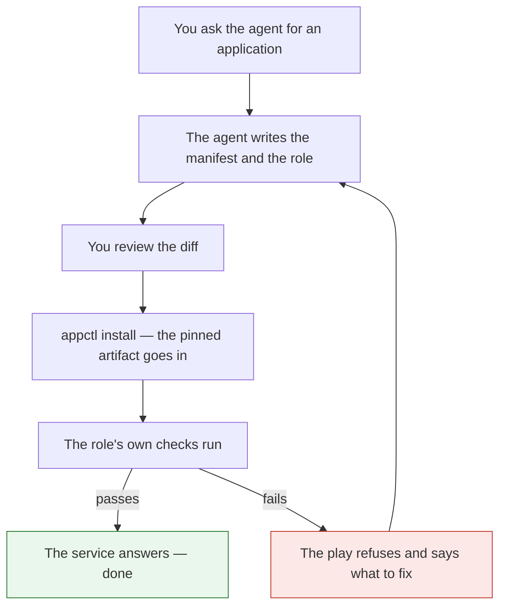

<p align="center">
  
</p>

# DeployFlow

**Point your coding agent at this repository and tell it to install an
application. It writes the deployment, you review it, and the service is
verified before anyone calls it done.**



DeployFlow is a workflow for delivering applications to servers. It defines
what an application needs, how it should be installed, and how we know it
actually works. The agent does the writing. The workflow does the proving.

The current implementation delivers to a container on a Proxmox host with
Ansible. That is the first destination, not the definition of the project.
The workflow itself — manifest, roles, checks, verification — is what
transfers when the next destination arrives.

## The problem it solves

An agent can write a deployment in a few minutes. What it cannot do, on its
own, is tell you the deployment is *correct*:

- The playbook finished green. That proves Ansible ran, not that the service
  works. A database file exists on a server that was never bootstrapped, and a
  process binds the wrong port — both produce a green play.
- The same steps run on every machine, and the differences between machines
  are where deployments break.
- The knowledge of "how this application should be installed" lives in
  someone's head, and leaves when they do.
- The next person, or the next agent, starts from nothing.

DeployFlow turns that into a repository an agent can work inside:

| | |
|---|---|
| **The application declares itself** | A manifest says where it comes from, what it needs, and what "working" means for it. |
| **The agent writes the delivery** | A role per application, generated against a documented contract, reviewable before it runs. |
| **The workflow proves it works** | Each application carries its own checks, and they run after every install. |
| **The steps are repeatable** | A second install on the same inputs changes nothing, and says so. |
| **The knowledge is in the repo** | The next agent reads it instead of guessing. |

## Try it

```bash
git clone https://github.com/bruj0/deployflow.git
cd deployflow
```

Then tell your agent:

> Read AGENTS.md and .agents/skills/deployflow-add-app/SKILL.md, then add support for
> <your application>. Use the deployflow-add-app skill. Show me the diff before you run
> anything.

The skill covers the manifest, the role, the pinned lockfile, the checks, and
the traps that make a run reinstall itself forever.

To look around first:

```bash
appctl targets      # which destinations exist, and which are not built yet
appctl list         # what this repository has configured
```

Or run one of the two shipped applications end to end. `builder` first, because
`omniroute` builds on it:

```bash
appctl install builder                       # the build host

# OmniRoute needs a checkout on this controller, and its secrets.
git clone https://github.com/cheaper-inference/OmniRoute.git
CHECKOUT=../OmniRoute                          # wherever you put it

# Point the role at your checkout. The default is the path it was developed
# against, so change it.
#   inventory/group_vars/omrsrc/main.yml -> om_local_source: <your path>

appctl secrets set omniroute_jwt_secret            --generate
appctl secrets set omniroute_api_key_secret        --generate
appctl secrets set omniroute_storage_encryption_key --generate
appctl secrets set omniroute_initial_password       --generate
appctl secrets set omniroute_ws_bridge_secret      --generate

apps/omniroute/build/omr-build-linux.sh "$CHECKOUT" main   # ~28 min
appctl install omniroute                         # deploy and verify
appctl install omniroute                         # must be changed=0
```

The build takes about half an hour because it compiles a 2 GB JavaScript tree
on the guest's platform. That is the cost of not shipping a darwin binary to
a linux server.

## How it works

```
you:  "install a new application"
agent: reads the contract, writes the manifest and the role,
       runs the checks, reports what it changed and what it verified
you:   reviews the diff, approves the run
run:   installs the pinned artifact, then checks the service actually answers
```

Four parts:

### 1. The manifest

What an application is: where its code comes from, what configuration it takes,
which secrets it needs, and which destination runs it. One file, `app.yaml`:

```yaml
applications:
  myapp:
    description: what it is, in one line
    target:
      kind: proxmox_lxc        # the destination that runs it
      options:
        hostname: myapp
        vmid: 121
    source:
      kind: repo               # a checkout, built here
      repo: /path/to/myapp
      ref: HEAD
    build:
      python_version: "3.14"
      verify_lock: true        # refuse a lock entry with no hash
    config:
      target: "{{ app_state_dir }}/config.json"
      files:
        - apps/myapp/config.yml
      vars:
        app_port: 9000
    secrets:
      - myapp_api_key
```

The `source:` block says where the code comes from. There are three kinds,
because there are three genuinely different things to say:

| Kind | What it is | What has to happen first |
|---|---|---|
| `package` | a published version | nothing — the artifact already exists |
| `repo` | a commit in a checkout | the artifact has to be built |
| `toolchain` | nothing at all — the application *is* the environment | the role assembles it |

The third is the unusual one, and it is what makes the workflow general
enough to build the other two. It is explained in
[Three kinds of application](#three-kinds-of-application).

### 2. The application role

How it is installed, in one directory per application. The agent writes this;
it follows the contract in `AGENTS.md`:

```yaml
# apps/myapp/tasks/main.yml
- name: Install the application
  ansible.builtin.pip:
    requirements: "{{ role_path }}/files/requirements.lock"
    virtualenv: "{{ app_venv }}"
    extra_args: "--require-hashes"

- name: Check that the application answers a request
  ansible.builtin.uri:
    url: "http://127.0.0.1:{{ app_port }}/"
  register: app_endpoint
  failed_when: false

- name: Fail when the application does not answer
  ansible.builtin.fail:
    msg: "The service listens but does not answer"
  when: app_endpoint.status is undefined
```

### 3. The target

Where it runs. The manifest names one, and the target owns everything about
that destination:

```python
# src/appctl/targets/proxmox_lxc.py
@register
class ProxmoxLxcTarget(Target):
    kind = "proxmox_lxc"
    summary = "an application installed into a Proxmox LXC guest with Ansible"

    def validate(self, context):
        """Reject a bad setup before anything is built or started."""
        if not context.app().target.options.get("hostname"):
            raise TargetError("target is missing: hostname")

    def deploy(self, context, artifacts, rendered):
        """Install it, run its checks, and report what was observed."""
        ...
```

Two more destinations are named so a manifest can ask for them and get a clear
answer, but they are not built yet:

```console
$ appctl targets
implemented targets:
  proxmox_lxc: an application installed into a Proxmox LXC guest with Ansible
planned, not implemented:
  docker_vm: provision a virtual machine and run the application in Docker there
  vm: provision a virtual machine and install the application into it
```

### 4. The checks

The part most tools skip. A deployment is not done when the command succeeds.
It is done when the service answers. Each application carries its own checks,
because only the application knows what "working" means for it:

```yaml
# apps/myapp/tasks/main.yml
- name: Check that the package imports
  ansible.builtin.command:
    argv: ["{{ app_venv }}/bin/python", "-c", "import myapp"]
  changed_when: false

- name: Check that the service is listening on the requested port
  ansible.builtin.command:
    argv: [ss, -ltn]
  changed_when: false
  register: app_listeners

- name: Fail when the service is not listening on the requested port
  ansible.builtin.fail:
    msg: "The service is running but not listening on port {{ app_port }}"
  when: app_port | string not in app_listeners.stdout
```

The port check matters more than it looks. `systemctl is-active` says the
process is up; it does not say the process bound the port you asked for. A
service that came up on 8000 instead of 9000 passes an is-active check and
fails every request.

## Three kinds of application

Most applications come from somewhere: a registry, or a checkout. Some
applications *are* somewhere — they are the machine other applications are
built on, and they install nothing at all.

That is the third kind, and the workflow needs it to describe its own build
hosts honestly:

```yaml
builder:
  description: the guest other applications are built on
  target:
    kind: proxmox_lxc
    options:
      hostname: builder
      vmid: 123
  source:
    kind: toolchain          # no package, no repo, no build
  secrets: []
```

A toolchain application:

- **installs no service** and publishes no port;
- **has no artifact**, so `appctl build` on it says so and exits non-zero
  rather than silently succeeding;
- **has no dependency on `common/python`** — that dependency is what asserts
  `app_port` is defined, and a build host serves nothing;
- **asserts the machine, not the install.** Its role checks that the guest is
  the right architecture, that the runtime is the pinned one, that it has
  enough memory and disk, and that it can reach the package registry. A role
  that installs a compiler and reports success has not said anything about
  whether a build can run on it.

That last point is the difference that matters, and it is measured. A builder
created with 12 GB of RAM passed every install check and then failed during
a build, with an error that named a memory limit and not the guest — and the
guest stopped answering SSH entirely. The role now asserts the floor it needs
before the build starts.

The worked example is [`apps/builder/`](apps/builder/).

## Ready-to-use applications

The repository ships two applications that work, not just two that illustrate.
They are the ones an agent would otherwise have to write from scratch, and
between them they cover the two shapes that are hard to get right.

### `omniroute` — an application built from a source checkout

[OmniRoute](https://github.com/cheaper-inference/OmniRoute) is a Next.js
server with a native SQLite binding, built from the upstream `main` branch and
served by one systemd unit on one guest.

| | |
|---|---|
| Source | `cheaper-inference/OmniRoute` at `main`, resolved to a commit |
| Build | on a native x86_64 build host — never on the controller, never emulated |
| Runtime | Node 24.14.1, pinned and checksummed |
| Ports | 20128 — dashboard, `/v1` proxy, MCP/A2A and management API; 20132 — the live dashboard WebSocket |
| Secrets | five, all generated, none ever in `argv` |

Two things make it the hard case, and both are things an agent gets wrong on
its own:

**The build cannot run where the agent is.** The controller is arm64 macOS;
the guest is x86_64 Linux. A tree built on the controller carries darwin-only
native binaries that fail on the guest much later, as an unrelated error deep
in a request handler. And an emulated container is not the answer either:
esbuild is a Go binary, and the Go runtime faults under qemu with
`fatal error: receive on synctest channel from outside bubble`. The build
host has to be native.

**The role refuses rather than rebuilds.** A role that rebuilds on every play
cannot tell "no changes" from "rebuilt". The build writes a receipt naming
the commit it was built from, and the role refuses to ship a tree whose
receipt does not match the checkout — so a stale tree is a refusal with a
message naming the command to run, not a silent deployment.

Its checks are worth reading, because they are the ones a green play hides:

| Assert | Guards against |
|---|---|
| the native SQLite binding loads and takes a write | a tree built for the wrong platform |
| the listener is on the address the role configured | a process listening somewhere else |
| `/v1/chat/completions` answers 401 without a key | an inference plane any device on the network can spend |
| `/api/providers` answers 401 | a dashboard serving an anonymous caller |
| the unit is enabled | a service that does not come back after a reboot |

See [`apps/omniroute/`](apps/omniroute/) for the role, and
[apps/omniroute/docs/BUILDING-FROM-SOURCE.md](apps/omniroute/docs/BUILDING-FROM-SOURCE.md)
for what building it taught — the failures, and why each one looked like
something else.

### `builder` — the build host

The guest the OmniRoute build runs on. It installs a compiler, a pinned Node
and a workspace, and it installs no service of its own.

```bash
appctl install builder
```

It publishes its address to `tmp/builders/builder.endpoint`, because guest
hostnames do not resolve from the controller — Proxmox's resolver is not the
controller's — and a build script that cannot find the machine cannot use it.

See [`apps/builder/`](apps/builder/).

## What you get when the agent does it

A reviewer reading the diff sees the intent, not a wall of generated YAML:

- the manifest block for the new application,
- one role directory with the install steps and the checks,
- a pinned dependency lockfile, so the tree that installs is the tree that was
  reviewed,
- a recorded `state:` block saying what was built and when it was last
  installed.

The agent's own reasoning stays in its session. What lands in the repository is
declarative and reviewable.

## Where each feature lives

The same list as a map, for when you want to go straight to the file.

| Feature | What it gives you | Where |
|---|---|---|
| **Declarative application manifest** | One file describes every application: source, config, secrets, destination. Unknown keys are an error, so a typo fails loudly. | `app.yaml` |
| **Agent-written application roles** | A scaffold, a contract and a checklist, so an agent can write a new role that matches the others. | `.agents/skills/deployflow-add-app/` |
| **Reproducible artifacts** | Every dependency pinned by hash. The build refuses a lockfile without one. | `appctl build` |
| **Application-level verification** | Each app checks that it imports, is active, listens where it was asked to, and answers a request. | `apps/<app>/tasks/` |
| **Idempotency check** | A second install reports `changed=0`, which proves the run is repeatable rather than reinstalling itself. | `appctl install` |
| **Secrets out of the repository** | Secrets live in a gitignored file, reach the run in a mode-0600 file, and never appear in `argv` or in the logs. | `appctl secrets` |
| **Pluggable destinations** | A target interface separates "what the application is" from "where it runs". One target ships today. | `src/appctl/targets/` |
| **Fails before side effects** | An unsupported destination or a missing secret stops the run before anything is built, downloaded or started. | `appctl install` |
| **Run evidence** | Every run keeps its commands, log, recap and errors, so a failure is a file to read rather than a scrollback to search. | `tmp/runs/` |
| **Build hosts as applications** | A guest whose purpose is to build other applications is a `toolchain` source: it installs no service, and its role asserts the machine can build rather than that an install succeeded. | `apps/builder/` |
| **Applications that work, not just illustrate** | Two shipped applications cover the two hard shapes: a service built from a source checkout, and the build host that builds it. | `apps/omniroute/`, `apps/builder/` |

## Requirements

### To use the workflow with an agent

| Requirement | Why |
|---|---|
| A coding agent that can read a repository and write files | The agent writes the manifest and the role. |
| An agent that follows the repository's instructions | `AGENTS.md` and `.agents/skills/deployflow-add-app/` hold the contract and the checklist. |
| A git repository per deployment | The manifest and the roles are the source of truth and the review surface. |
| A place to keep secrets | A `.env` file, gitignored. The agent never needs to read a secret value. |

### To run a delivery on the current target

| Requirement | Detail |
|---|---|
| A Proxmox VE host | You need `pct` and SSH access to it. |
| A cached Linux template on that host | The guest is created from it. |
| SSH access from the controller to the host | The framework drives `pct` over SSH. |
| `ansible-playbook` on the controller | The play does the configuring. |
| Python 3.12 or later on the controller | That is the CLI's own requirement. |
| A real application to install | The sample role is a reference. Point the agent at your application. |

For the `omniroute` application specifically, three more things are needed,
and all three are consequences of building from source rather than
installing a release:

| Requirement | Why |
|---|---|
| A checkout of OmniRoute on the controller | The role ships a tree; it does not fetch one. The build host clones it for itself, so it needs to be reachable from the guest. |
| The build host provisioned | `appctl install builder`. The build cannot run on the controller and must not run emulated. |
| 24 GB of RAM on the Proxmox host | The build's webpack process reaches 11.5 GB RSS. The builder role asserts this and refuses a host that is too small. |

The first guest also needs a bridge and storage on the Proxmox host, and a
network path from the controller to the guest. The role discovers the guest's
address over DHCP, so you do not configure one.

SSH access means whatever your SSH setup already provides. The framework
does not read `~/.ssh/config` by name, and it does not need one. If you keep
your hosts in an SSH config, name the host in the inventory and the alias
resolves on its own:

```yaml
all:
  children:
    proxmox:
      hosts:
        pve:
          ansible_host: pve.example.net   # a Host block in ~/.ssh/config
          ansible_user: root
```

### To add a new destination

| Requirement | Detail |
|---|---|
| A target implementation | One file under `src/appctl/targets/`. See [docs/targets.md](docs/targets.md). |
| The target's own prerequisites | It validates them before the run starts. |
| Checks that fit the destination | The application's own checks still apply; the target adds its own. |
| An acceptance test on a real host | The same application, installed twice, with one deliberate failure caught by a check. |

## Documentation

| | |
|---|---|
| [docs/overview.md](docs/overview.md) | The current implementation: the `appctl` command, the Proxmox LXC target, the manifest and the roles |
| [docs/targets.md](docs/targets.md) | The target interface, and how to add a destination |
| [docs/architecture.md](docs/architecture.md) | How the parts fit together, and the rules that must hold |
| [docs/configuration.md](docs/configuration.md) | Every key in the manifest |
| [docs/build-pipeline.md](docs/build-pipeline.md) | How an artifact is produced and pinned |
| [docs/rendering.md](docs/rendering.md) | How YAML becomes the configuration the server reads |
| [docs/secrets.md](docs/secrets.md) | How a secret reaches the server |
| [apps/omniroute/](apps/omniroute/) | A working application built from a source checkout: the role, and what building it taught |
| [apps/builder/](apps/builder/) | A working build host: the `toolchain` application |
| [AGENTS.md](AGENTS.md) | The rules for changing this repository |
| [CONTRIBUTING.md](CONTRIBUTING.md) | How to contribute, and what a change must preserve |

## Status

Early. The Proxmox LXC destination is implemented and tested against one host.
Two more destinations are interfaces only: they are named, so a manifest can
ask for them and get a clear answer, and they fail before anything is built.
See [docs/targets.md](docs/targets.md) for what each would have to prove before
it could be called supported.

## License

MIT. See [LICENSE](LICENSE).
</content>