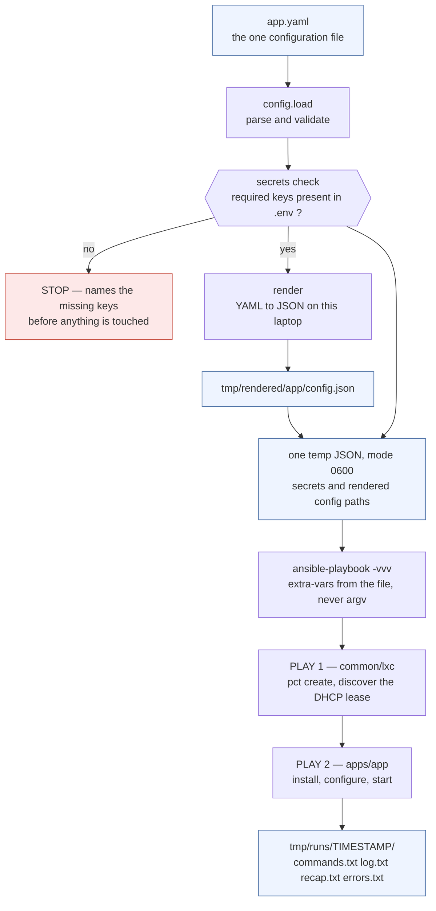
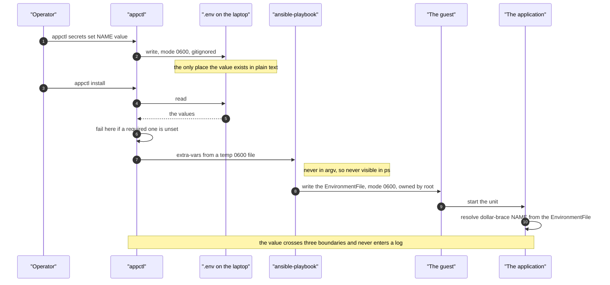

# Architecture

How `appctl` fits together. Read [../README.md](../README.md) for why it is
built this way and [../AGENTS.md](../AGENTS.md) before changing it.

- [Data flow](#data-flow) — one end-to-end run
- [Modules](#modules) — what owns what
- [Why the boundary](#why-the-boundary-holds) — the rule and its consequences
- [Extension points](#extension-points) — where a change belongs
- [Invariants](#invariants) — what must stay true

## Data flow

What happens when you run `appctl install`. One question per diagram: what
happens, in order; then where a secret goes.



Three things are worth noticing.

**Nothing for configuration runs on the guest.** `render` happens on your
laptop. The play copies a finished file. An application needs no code of its own
to be configured.

**The extra-vars file is flat.** `--extra-vars @file` does not unwrap an
`ansible:` key; that namespace is a config-file convention. A wrapped file is
accepted without complaint and defines nothing, so every secret arrives empty
while the controller holds good values. Measured both ways.

**Rendered-config paths travel in the same file as the secrets** rather than on
the command line. They are controller paths and harmless, and keeping the whole
variable set in one place means one file to delete.

### Where a secret goes

`appctl install` is the same command, followed through time. The value crosses
three boundaries and never reaches a log.



In a rendered config file a secret appears only as a `dollar-brace NAME`
reference, which the guest resolves at startup. That is what makes a config file
safe to commit.

`appctl build` is a separate path and does not appear above: it produces the
wheel and the lockfile that the play later installs. See
[build-pipeline.md](build-pipeline.md).

## Modules

| Module | Owns | Knows about applications? |
|---|---|---|
| `config.py` | the schema of `app.yaml` and nothing else | no |
| `targets/` | where and how an application runs | no — a target is not an application |
| `secrets.py` | `.env` parsing, writing, checking | no |
| `render.py` | YAML → JSON with `{{ }}` substitution | no |
| `build.py` | wheel + lockfile from a git checkout | no — a repo is a repo |
| `install.py` | running Ansible, streaming, redaction | no |
| `state.py` | writes the `state:` block into `app.yaml`, as text | no |
| `cli.py` | argument parsing, dispatch, exit codes | no |
| `errors.py` | the exception hierarchy | no |

Dependencies flow one way. `cli` depends on everything. `install` and `render`
depend on `config`. Nothing depends on `build` except `cli`. There is no import
cycle and no module imports two others for convenience.

### Why `config.py` is the centre

Every other module needs the same three things: which applications exist, where
the repository root is, and what each one requires. That is `Config`. Parsing it
in one place, with one strictness policy, means a typo in `app.yaml` fails once
and names the key — rather than surfacing later as a service listening on the
wrong port.

## Why the boundary holds

The repository is split into two role roots:

```
common/   the framework — names no application
apps/     one directory per application
```

`src/lxc/` sits on the framework side. The boundary is not decorative: it is
what makes adding an application safe.

**The cost.** Some things that would be convenient are unavailable. The tool
cannot pre-check that an application's unit name is correct, cannot know that
example-app needs two ports, cannot offer a `--example-app` flag. Each of those would be
a piece of the framework that knows about an application, and the second
application needing the same thing would turn it into either a duplicate or a
conflict.

**The benefit.** Adding an application cannot break an existing one, because
nothing shared changed. `apps/example-app` and `apps/another` coexist with no shared
code beyond the contract, and each derives every path from `app_name`.

The `app_name` clause in the contract follows from the same rule. The framework
declares **no default** for it, because a role's `meta` dependency has its
defaults applied after the including role's own — so a framework default would
silently override the application's. That was masked while there was one
application, because its name happened to equal the default.

## Extension points

Where a change belongs:

| You want to… | Put it in |
|---|---|
| configure an application differently | `apps/<app>/config.yml` and its `app.yaml` `config:` block |
| install a different artifact | `apps/<app>/` and the `source:` block |
| require another secret | the `secrets:` list in `app.yaml` |
| change how guests are created | `common/lxc/` |
| support another delivery target | `src/appctl/targets/` — see [targets.md](targets.md) |
| change the venv contract | `common/python/` |
| add an application | `apps/<app>/` — see the `add-lxc-app` skill |
| add a `appctl` command | `src/lxc/cli.py` plus a new module |
| teach the tool an application name | **nowhere.** Put it in `apps/`. |

## Invariants

These must hold. Each was a real failure before it became a rule.

**A secret never reaches a log.** Ansible echoes extra variables back at `-vvv`
from two places: the argument vector and its own `extra_vars:` output.
`install.py` rewrites both. Verify:

```bash
appctl install <app> -- -e some_secret=PLAINTEXTVALUE
grep -rl PLAINTEXTVALUE tmp/        # must print nothing
```

**A second run reports `changed=0`.** A role that reports a change on every run
is reinstalling itself, which tells you nothing about its own state. The usual
cause is a sentinel that can never succeed — it looks like a guard and silently
holds a gate open. `'changed' in "unchanged"` is True; an import of a name that
does not exist always fails; a glob read by `next()` twice raises
`StopIteration`.

**An unknown key in `app.yaml` is an error.** A misspelled key is otherwise a
silent no-op.

**An unimplemented target fails before any side effect.** A manifest that
names `vm` or `docker_vm` is refused while nothing has been built, downloaded
or started. The registry never falls back to `proxmox_lxc`: an application
that asks for a virtual machine must not be silently installed into a
container.

**The shared code names no target.** `pct`, the container ID, the template and
the guest network live in `targets/proxmox_lxc.py`. A module outside
`targets/` that mentions one of them is in the wrong place.

**A record is written to `app.yaml` after every build and install**, and only
the `state:` block is rewritten — never the whole file, because a YAML
round-trip destroys the comments that explain why each value is what it is.

**Run logs are never pruned.** `appctl` deletes exactly one file: the temporary
extra-vars file. Everything under `tmp/runs/` survives.

**`appctl install X` also runs the `lxc` tag.** Play 1 is what discovers the DHCP lease.
Without it play 2 cannot resolve the guest at all. It is guarded by a stat, so
on an existing guest it costs a few no-op tasks.