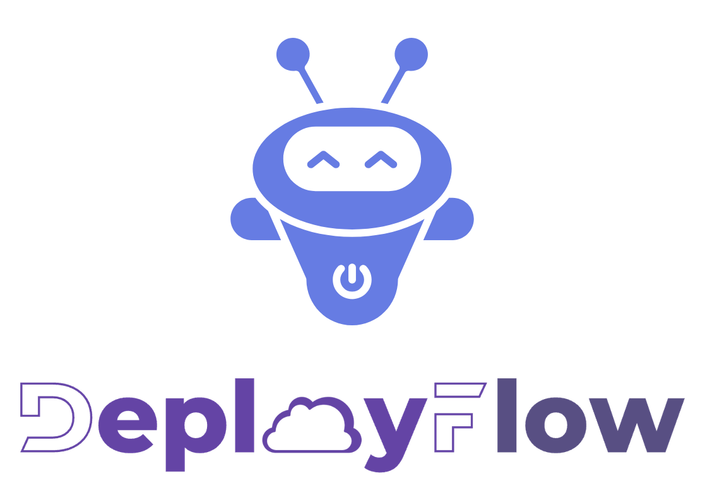

<p align="center">
  
</p>

# DeployFlow — reference

This is the reference for the current implementation: the `appctl` command, the
Proxmox LXC target, the manifest and the Ansible roles.

For what the workflow is and why you would point an agent at it, read the
[project README](../README.md). Start with that one.

---

Deploy applications to Proxmox LXC containers with Ansible, then verify the
service works — not just that the deployment command succeeded.

The tool is `appctl`. It builds a pinned artifact, installs it into a guest,
and then runs checks that reach the application the way a user does.

```bash
appctl targets                     # what can be delivered to, and what cannot yet
appctl list                        # what is configured
appctl build example-app           # produce the artifacts the role installs
appctl install example-app         # install it and check that it answers
appctl secrets check               # are the required secrets set?
```

## What it does

A stock Ubuntu template goes in, Ansible configures it, and the application
runs under systemd with a sha256-pinned dependency tree. No container image is
built, so there is no tarball to store and no image registry in the loop.

| | |
|---|---|
| Install | a pinned application into a Proxmox LXC guest, with Ansible |
| Reproducibility | the lockfile carries a hash for every dependency; the build refuses one that does not |
| Verification | application-level checks after the install, not only a green playbook |
| Secrets | in a gitignored `.env`, passed to Ansible in a mode-0600 file, never in `argv` |
| Build hosts | a build host is an application too — a `toolchain`, provisioned and asserted like any other |

## Why the checks matter

Ansible reporting success proves that Ansible ran. It does not prove the
application is usable. Each of these passed review and only failed in use:

| The check | What it catches |
|---|---|
| The package imports | A dependency tree that did not install |
| The unit is active | A service systemd accepted and then dropped |
| The port is listening | A process that bound somewhere other than the requested port |
| The endpoint answers | A service that listens and returns nothing |

Every application role carries its own checks, because only the application
knows what "working" means for it. The sample role in `apps/example-app/`
shows the pattern.

## The three kinds of application

A manifest says where an application's code comes from. There are three kinds,
and they differ in more than the value of `source.kind` — they differ in what
has to happen before the application can be installed.

| Kind | Source | Has an artifact? | `appctl build` |
|---|---|---|---|
| `package` | a published version | yes — it already exists | exits non-zero: nothing to build |
| `repo` | a commit in a checkout | no — it has to be built | builds it |
| `toolchain` | nothing | no — it *is* the environment | exits non-zero: nothing to build |

A **toolchain** is an application whose purpose is to be the environment
another application is built in. It installs no service, publishes no port,
and has no artifact. Its role assembles what a build needs and asserts the
machine can build:

```yaml
builder:
  description: the guest other applications are built on
  target:
  source:
    kind: toolchain
  secrets: []
```

Three things follow from it being a toolchain, and each is deliberate:

**No dependency on `common/python`.** That dependency is what asserts
`app_port` is defined, and a build host serves nothing. A role with no
dependency still runs — play 2 loops over each host's `app_roles` and
`include_role`s it — so no playbook changes.

**The postconditions are about the machine, not the install.** A role that
installs a compiler and reports success has not said anything about whether
a build can run on it. The builder asserts the architecture, the pinned
runtime, the memory, the disk and the registry's reachability.

**The minimums are measured, not guessed.** A builder created with 12 GB of
RAM passed every install check and then failed during a build, with an error
naming a memory limit rather than the guest — and the guest stopped
answering SSH entirely. The role now refuses a guest below the floor it
needs.

The two shipped applications are the two hard shapes:

| Application | Shape | What it shows |
|---|---|---|
| [`apps/omniroute/`](../apps/omniroute/) | `repo` — built from a checkout | a source build that refuses a stale tree, and checks an inference plane's key gate |
| [`apps/builder/`](../apps/builder/) | `toolchain` | a guest that exists to build the other one |

## Targets

A **target** says where and how an application runs. The manifest names one:

```yaml
applications:
  example-app:
    target:
      kind: proxmox_lxc
      options:
        hostname: example-app
        vmid: 121
```

`proxmox_lxc` is the only implemented target. Two more are planned:

| Target | What it would do | Status |
|---|---|---|
| `vm` | Provision a virtual machine and install the application into it | planned |
| `docker_vm` | Provision a virtual machine and run the application in Docker there | planned |

A manifest that names an unimplemented target fails **before** it builds,
downloads or starts anything:

```
error: target kind 'vm' is planned but not implemented

provision a virtual machine and install the application into it.
implemented targets: proxmox_lxc
```

That failure is deliberate. An application that asks for a virtual machine must
not be silently installed into a container instead.

## Quickstart

You need a Proxmox VE host, a cached Linux template on it, and SSH access to
the host.

```bash
git clone https://github.com/bruj0/deployflow.git
cd deployflow

uv tool install --editable .

cp app.example.yaml app.yaml        # then edit it
cp inventory/hosts.yml inventory/hosts.yml   # already a copy; edit the host
```

Edit three things:

1. `app.yaml` — the application, its port and its target options.
2. `inventory/hosts.yml` — your Proxmox host and the guest.
3. `inventory/group_vars/all/main.yml` — your SSH public key.

Then:

```bash
appctl secrets init                  # create .env from the required keys
appctl secrets set NAME 'value'      # add each secret
appctl secrets check                 # confirm they are all set
appctl render                        # see the configuration before it lands
appctl install example-app
```

Run the install a second time. It should report `changed=0`: the same inputs
produce the same guest.

## What an application role owes the framework

An application is one directory under `apps/`. Nothing in `common/` or
`playbooks/` changes when you add one.

```yaml
# apps/myapp/defaults/main.yml
app_name: myapp        # the only required value
app_port: 9000
```

```yaml
# apps/myapp/meta/main.yml
dependencies:
  - role: python       # declares the dependency, so no playbook changes
```

`app_name` derives the service account, the directories, the virtual
environment and the unit name. `app_port` has no derivation and you must set it.

## Layout

```
app.yaml                 the one configuration file: applications and targets
common/                  framework. Names no application, anywhere.
  lxc/                   pct create from a stock template, DHCP, address discovery
  python/                toolchain, service account, venv — the contract
apps/                    one directory per application
  example-app/           the sample used by the quickstart
  omniroute/             OmniRoute, built from a source checkout
    build/               the build script and its host-side half
    docs/                what building it taught
  builder/               a toolchain: the guest other applications are built on
src/appctl/              the appctl package
  targets/               the delivery-target interface and its implementations
    proxmox_lxc.py       the only implemented target
docs/                    architecture, configuration, rendering, secrets, build
playbooks/site.yml
inventory/               guests; the only file you edit to add one
```

`roles_path = common:apps`. A role's `meta` dependency declares what it needs,
so adding an application never edits a playbook.

## Commands

| Command | What it does |
|---|---|
| `appctl list` | Every application, its target, its destination and its last install |
| `appctl targets` | The implemented targets, and the planned ones that are not built |
| `appctl init` | Write a starting `app.yaml` |
| `appctl build <app>` | Produce the artifacts the role installs |
| `appctl build --check` | Verify the committed artifacts and build nothing |
| `appctl render` | Render the application configuration, without deploying |
| `appctl install <app>` | Install it and run the checks |
| `appctl secrets init\|set\|list\|check` | Manage the `.env` |

Anything after a bare `--` goes straight to `ansible-playbook`:

```bash
appctl install example-app -- --check --diff
```

## Documentation

| | |
|---|---|
| [docs/architecture.md](../docs/architecture.md) | How the parts fit together, and where the target boundary is |
| [docs/configuration.md](../docs/configuration.md) | Every key in `app.yaml` |
| [docs/build-pipeline.md](../docs/build-pipeline.md) | How an artifact is produced and pinned |
| [docs/rendering.md](../docs/rendering.md) | How YAML becomes the configuration the guest reads |
| [docs/secrets.md](../docs/secrets.md) | How a secret reaches the guest |
| [docs/targets.md](../docs/targets.md) | The target interface, and how to add a target |
| [../apps/omniroute/](../apps/omniroute/) | A working application built from a source checkout |
| [../apps/builder/](../apps/builder/) | A working build host — the `toolchain` application |

## Status

Early. `proxmox_lxc` is implemented and tested against one Proxmox VE node.
The `vm` and `docker_vm` targets are interfaces only. See
[docs/targets.md](../docs/targets.md) for what each would have to prove before it
could be called supported.

## License

MIT. See [LICENSE](../LICENSE).
