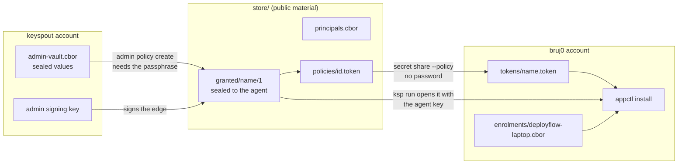

# Plan: Keyspout on this Mac, two accounts, replacing `.env`

**Status:** ready for the operator, 2026-11-22; stale claims corrected
2026-11-25 after Keyspout 1.1.0 + feature 015. Target: `bruj0-mac` (macOS,
arm64), Keyspout 1.1.0, DeployFlow at `~/Projects/deployflow`.

**What has been run against the product, and what has not.** §8 and §10.1–§10.5
were replayed on 2026-11-25 against the merged feature-015 tree, in a throwaway
home: `init`, `admin init`, `seal-vault`, `agent enroll`, `admin put --own`,
`admin policy create`, `secret share --policy`, `ksp run` (byte-identical value),
and revocation. **Nothing has been run against the real `keyspout`/`bruj0`
deployment**, and the root-requiring half of §9 — enrolling an account other
than the one running the command — has not been exercised here because this host
offers no non-interactive root. Everything in this plan that needs your hands
still does.

**Starting over?** Appendix E removes everything this plan creates, on both
accounts and the store inside it, so §5 is a clean start. Read E.2 before you
run it: the vault holds the only copy of any value you have already sealed.

You run every command in this plan. Every behaviour quoted was measured first in
throwaway homes under `/tmp`, and the probe is cited where it matters, so you
can re-run a check yourself instead of taking a line on trust.

Read §1 and §3 before you type anything. §3 lists what does not work, because
two of those were my first design and both are dead ends you would otherwise
discover at step 5.

---

## 1. Decisions

| # | Decision | Why |
| --- | --- | --- |
| D1 | Admin account is the existing `keyspout` account (UID 502). | Already created, `staff` group, `/bin/zsh`, home `/Users/keyspout`. |
| D2 | **One home, two accounts.** `KSP_HOME` is `/Users/keyspout/.ksp` for both; the boundary is file ownership inside it, not one home each. | This is the layout `QUICKSTART.md` documents and the one the repo's own two-account test uses. The per-account-home layout (spec 014's `CF-001`) is **broken in 1.1.0** in four places — §3.1, filed upstream as D1–D4. |
| D3 | Delivery is a **policy-bound grant**: `admin put --own` → `admin policy create` → `secret share --policy` → `ksp run`. | The leased-copy path cannot be renewed; see §3.2. |
| D4 | `appctl` grows a `keyspout` secrets provider. `.env` stays supported as the default until you flip it. | Keeps the tool usable by anyone who has not set Keyspout up, and makes the cutover reversible by one config key. |
| D5 | Grant window is **2 hours**, extended by a LaunchDaemon every 30 minutes with `admin policy update --expires-at`. | Extending a window needs **no passphrase** (measured, §13.1), so the 2-hour bound costs nothing operationally. Revocation is `admin policy delete`, which also needs no passphrase. |
| D6 | All 15 `.env` keys move into Keyspout; `.env` is deleted. | 10 are role inputs and go through `appctl`. 5 are the operator's own (`GITHUB_PAT_PROJECTS`, `mistral_keys_api`, `mistral_keys_vibe`, `cloudflare_token_creator`, `omniroute_api_key`) and are read with `ksp run` by hand. One vault, no plaintext left behind. |
| D7 | The admin passphrase never lives on disk **between runs**. A `0600` file created from a prompt for one batch, then removed, is allowed and is what §10.3 uses. | Only three commands need it (`admin user add`, `admin seal-vault`, `admin policy create`). One of them is typed ten times in a row, and ten identical prompts teach you to stop reading them. |

---

## 2. Measured state

### 2.1 The machine

| Thing | Value | How it was read |
| --- | --- | --- |
| `keyspout` account | UID **502**, primary group `staff` (gid 20), shell `/bin/zsh`, home `/Users/keyspout` (0755 `keyspout:staff`) | `dscl . -read /Users/keyspout …` |
| `keyspout` groups | `staff, everyone, localaccounts, com.apple.sharepoint.group.1, _lpoperator, com.apple.sharepoint.group.2` | `id -Gn keyspout` |
| `/Users/keyspout/.ksp` | **empty**, 0755 `keyspout:staff` | `ls -la` |
| `bruj0` home | `/Users/bruj0`, admin, in `staff` | `id -Gn bruj0` |
| `/Users/Shared` | `drwxrwxrwt root:wheel` (sticky, world-writable) | `stat -f` |
| `ksp` on `PATH` | `/opt/homebrew/bin/ksp`, **1.0.2** | `ksp version` |
| Source build | `/Users/bruj0/Projects/keyspout/target/debug/ksp`, **1.1.0** | `target/debug/ksp version` |

Both accounts are in `staff`, and that is the whole reason `staff` is the right
group: `admin user add` resolves the store root's gid and makes the enrollee a
member of it. Because both are already members, the membership check passes
instead of needing a privileged directory-services write.

The user only ever **reads** the store; the admin writes it. That asymmetry is
what makes `keyspout:staff` the correct owner rather than a shared-write
directory. The probe that failed at `dseditgroup` did so because its store sat
in `/tmp` and inherited `wheel` — see the note below.

> `/Users/Shared` is world-writable with the sticky bit and owned by `wheel`.
> A directory created there inherits **`wheel`**, not `staff` — measured by the
> probe, and the source calls this out at `admin.rs:305`. So the store must be
> `chown`ed explicitly (§7.1). Skip that and `admin user add` fails at the
> group binding with a message about `dseditgroup`.

### 2.2 The existing deployment under `/Users/bruj0/.ksp`

| Property | Value |
| --- | --- |
| Layout | single-account (admin and user are the same principal) |
| Vault | `vault-1` |
| Admin key id | `admin-2026` |
| User | `7d322e7a-…`, bound to `bruj0` |
| Records | `db_password`, `db_password2` (test values) |
| Agent | `3684cc3d-…` |
| Policy revision | 3 |
| Audit | 76 records |
| Sweep proof | **stale** — 66851 s old against a 5400 s bound |
| LaunchAgent | `~/Library/LaunchAgents/ksp-sweep.plist`: `target/debug/ksp secret gc` every hour, `KSP_HOME` pinned, **no log paths** |

That job has been failing silently. It runs the **1.1.0** debug binary against
the **pre-014** layout, which 1.1.0 refuses outright:

```
ksp: this home holds the pre-014 layout: …/policy.cbor exists and no principal
     registry does; this build cannot read its grants as access edges, has no
     conversion tool for them, and will not modify the tree
ksp: refused (exit 7)
```

The plist names no `StandardOutPath`, so the refusal went nowhere, and the stale
proof in the row above is the result. Disabling it in §6.1 therefore changes
nothing that was still working.

It holds no real secret and its sweep proof is expired, so it is retired rather
than migrated (§6).

### 2.3 The secrets in `.env`

| Declared by `app.yaml` (10) | Undeclared (5) |
| --- | --- |
| `omniroute_jwt_secret` | `omniroute_api_key` |
| `omniroute_api_key_secret` | `GITHUB_PAT_PROJECTS` |
| `omniroute_storage_encryption_key` | `mistral_keys_api` |
| `omniroute_initial_password` | `mistral_keys_vibe` |
| `omniroute_ws_bridge_secret` | `cloudflare_token_creator` |
| `omniroute_release_jwt_secret` | |
| `omniroute_release_api_key_secret` | |
| `omniroute_release_storage_encryption_key` | |
| `omniroute_release_initial_password` | |
| `omniroute_release_ws_bridge_secret` | |

`omniroute_api_key` appears in `apps/omniroute/README.md` and `.env.example`
but **not** in the role's template (`omniroute-secrets.env.j2` renders
`API_KEY_SECRET={{ omniroute_api_key_secret }}`), so it is not a role input.
The other four are referenced nowhere in the repository.

---

## 3. What does not work, and why

Each of these was probed. They are here so a failure at step 9 reads as "known
dead end, already rejected" rather than "my setup is broken".

### 3.1 Per-account homes (`--home`) — **superseded by §3.4, do not use**

I first read spec 014's *decision* — *"the home stays per-account and the store
root becomes configured"* — and built this plan on it: each account gets its own
`~/.ksp`, both point at one `KSP_STORE`.

**That topology did not work in 1.1.0, and four defects said so.** It is the
layout the design spec chose and the one this plan used to recommend. I filed
the four against the upstream tree as `docs/known-defects.md` D1–D4; **all four
are fixed** (feature 015, merged 2026-11-25) and that document has removed their
entries, keeping a table of the fixing commits:

| What breaks | Effect |
| --- | --- |
| The second home gets no `config.toml`, and the user cannot write one (the home is `0711` root-owned) | `ksp run` refuses at exit 7 on every delivery |
| `admin user add` chowns the admin's `policy-events.jsonl` to **root**, because it asks the *target* home who the admin is | `admin policy create` refuses: `Permission denied` |
| `admin list` cannot `read_dir` the user's `0711` store directory | **fixed** — the listing reports the directory it could not read instead of failing |
| `admin list` prefixes on the deployment record's single `user` field | **fixed** — it enumerates the Principal Registry |

The first two are provisioning steps that do not hand over what the next
command needs; they are not operator error, and each has a verified workaround
(§3.4). **All four were fixed in Keyspout feature 015**, which merged on
2026-11-25: the two listing defects are gone in this plan's layout, and the two
provisioning ones are gone in the per-account-home layout they lived in. §3.4's
one-home layout is still the right choice for *this* deployment, because it is
the shipped one, but it is no longer the only layout that works.

Re-measured against the merged tree: `admin list` exits `0` in a two-principal
deployment, names records at the `admin` and `granted` levels, and a level it
cannot read is reported as
`p/vault-1/<principal>/admin (mode 0000, owner uid 501): Permission denied
(os error 13)` while the listing still exits `0`.

**Why no test caught it:** `QUICKSTART.md` never passes `--home`, and the two
suites that touch the topology assert *layout* — that a vault is in the right
home, that a registry is one file — never a delivery from a second home. The
canonical two-account walkthrough uses **one** home.

So the tool's supported two-account layout is the one in `QUICKSTART.md`: one
`KSP_HOME`, two accounts, the boundary carried by file ownership inside it.
§3.4 is that layout, and it is verified end to end on this machine with the
real `keyspout` and `bruj0` accounts.

The spec's per-home decision is still the right *direction* — the source says
why at `admin.rs:664` — but it is not shippable yet, and this plan does not
build on it.

### 3.2 Leased copies (`secret share --agent --ttl`)

A lease copy is named `<secret>-<agent>-<version>`. Minting a second copy for
the same triple — which is what a 2-hour TTL forces you to do — is refused:

```
ksp: refused
  the operation identity … already names a different deletion intent
```

`secret gc` and `secret purge-expired` remove the copy but leave
`store/intents/<id>` behind, and only deleting that intent by hand allows a
re-mint. A lease also needs an armed sweep proof in the same home, which is why
§3.1's shared home died at exit 7. Not recommended.

### 3.4 The layout that works: one `KSP_HOME`, two accounts

This is `QUICKSTART.md`'s layout, and it is the one every shipped artefact
assumes. The boundary is **file ownership inside one home**, not one home each:

```
/Users/keyspout/.ksp/                    0711  keyspout:staff   ← KSP_HOME, one home
├── config.toml                          0644  keyspout         read by both accounts
├── deployment.cbor                      0644  keyspout
├── admin/                               0700  keyspout         the admin's signing key
├── admin-vault.cbor                     0600  keyspout         sealed to the passphrase
├── admin-anchor.cbor                    0644  keyspout
├── policy.cbor                          0644  keyspout
├── vault.cbor                           0600  bruj0            ← the user's vault, hers
├── agent/                               0755  bruj0
├── enrolments/                          0755  bruj0
├── audit/                               0711  keyspout         one chain dir per writer
└── store/                               0755  keyspout:staff   ← the store, inside the home
    └── p/vault-1/<admin>/principals.cbor  0644
```

Verified on this machine, with the real `keyspout` and `bruj0` accounts, on the
`1.1.0` release binary:

| Step | Result |
| --- | --- |
| `ksp init` as `keyspout`, then `chmod 0644 config.toml` | ok — the file both accounts read |
| `admin init --vault vault-1 --user bruj0 --key-id keyspout` | ok |
| `admin seal-vault` | ok |
| `admin user add --unix-user bruj0` **as root** | ok — reports the principal |
| `agent enroll --agent deployflow-laptop` as `bruj0` | ok |
| `admin put --own` as `keyspout` | ok |
| `admin policy create` as `keyspout` | ok — the ledger is chowned to `keyspout`, not root |
| `secret share --policy` as `bruj0` | ok |
| `ksp run` as `bruj0` | ok — the value arrives |

Two things make it work that the per-home layout lacks:

- **One `config.toml`, written by the admin, widened to `0644`.** The guard
  refuses a file another principal can *write* (`WRITE_BY_OTHERS = 0o022`), not
  one it can read, so `0644` is the shape the two-account session is built on.
  QUICKSTART step 2 says exactly this.
- **The admin's ledger is chowned correctly.** `bind_principal_roots` is called
  with the admin's own home, so `admin_root_owner` reads the admin's key root
  and returns the admin account. In the per-home layout it is called with the
  *target* home and returns root (D16).

**One cost, stated plainly:** both accounts' material lives under one home
directory. The user's `vault.cbor` is `0600` and hers, the admin's key root is
`0700` and his, and the home itself is `0711` so neither can list it. That is a
weaker boundary than one home each — but it is the boundary the tool actually
enforces today, and it is the only one where the whole workflow completes.

#### What changes in this plan

| § | Was | Now |
| --- | --- | --- |
| §7 | create a shared store at `/Users/Shared/ksp` | **deleted** — the store is `<home>/store`, created by `admin init` |
| §9 | enrol `bruj0` into `/Users/bruj0/.ksp` | enrol `bruj0` into the **admin's** home; her vault is `0600` hers inside it |
| §10.1 | agent enrolled in bruj0's own home | the same home — `enrolments/` is `0775` hers |
| §11 | `secrets.home` = `/Users/bruj0/.ksp` | `secrets.home` = `/Users/keyspout/.ksp` — **one** home for every `ksp run` |
| §10.4 | tokens in `~/.ksp-tokens` | tokens in `~bruj0/.ksp-tokens` — outside the home, so bruj0 owns them outright |

§3.1's original claim — that a shared home "half-works" — was **wrong**, and
so was the reason: the problems I first found in it (`policy.cbor` per home, no
sweep proof in the user's home) are symptoms of the *lease* path, which the
policy path does not use. The policy path works in the one home, and it is the
path this plan uses.

### 3.3 What I got wrong inside the policy path

`admin policy create --user` must name the **enrolled** principal, i.e. the UUID
`admin user add` prints — not the one `admin init` printed. They are different
because `admin init` mints the deployment's first user principal and
`admin user add` mints another one (`admin.rs:704`). Passing the wrong one is
refused:

```
ksp: the policy edge names user <uuid>, which this deployment does not hold:
     enrol her first
```

§9.3 therefore captures `USER_ID` from **`admin user add`**, and §9.1's
`admin init` value is kept only as the admin principal.

---

## 4. Topology

One home, two accounts. The home belongs to `keyspout` and is `0711`, so
`bruj0` can traverse it and reach her own files without being able to list
what is in it or widen the directory.

```
/Users/keyspout/.ksp/                  0711 keyspout:staff  ← KSP_HOME, both accounts
├── config.toml                        0644  capability config — read by both
├── deployment.cbor                    0600  the deployment record
├── admin/                             0700  the admin's signing key
├── admin-vault.cbor                   0600  sealed to the passphrase
├── admin-anchor.cbor                  0644  the admin's verification key
├── policy.cbor                        0644  the grants this host holds
├── vault.cbor                         0600  bruj0 — her own records, hers
├── enrolments/                        0775  bruj0 — the agent's key file
├── agent/                             0775  bruj0 — agent key material
├── audit/                             0711  one 0700 chain dir per writer
└── store/                             0755 keyspout:staff
    ├── p/                             0711  traverse only, by design
    │   └── vault-1/
    │       ├── <admin-uuid>/          0711  keyspout
    │       │   ├── principals.cbor    0644  the principal registry
    │       │   ├── admin/<name>/     0750  the sealed admin record
    │       │   └── granted/<name>/1/ 0750  the publication entry
    │       └── <user-uuid>/           0711  bruj0
    │           ├── issuance.jsonl     0640  bruj0 writes, keyspout reads
    │           └── agents/<uuid>.cbor 0644  the agent's public keys
    └── intents/                       1770  unused on the policy path
```

**The two boundaries that matter.**

| Boundary | Enforced by |
| --- | --- |
| the admin's signing key and sealed vault | `0700` on `admin/` and `admin-vault.cbor`, owned by `keyspout` |
| the user's own records | `0600` on `vault.cbor`, owned by `bruj0` |

Everything else is shared on purpose: `config.toml` is `0644` because the
capability guard refuses a file another principal can **write** (`0o022`), not
one it can read, and the user must read it. `store/` is group-readable because
the publications and delivery tokens in it are public material by design — each
publication is sealed to one agent, and each token carries no content key.

**What the deployment never sees.** The values at rest are in
`admin-vault.cbor`, sealed to a key whose private half is behind the admin
passphrase, in a `0700` directory owned by `keyspout`. A value crosses to
`bruj0` only through a grant the admin signed, and only for as long as that
grant's window is open.



## 5. Phase 0 — preflight

Run as `bruj0`, from `/Users/bruj0/Projects/deployflow`.

### 5.1 Upgrade the binary

1.0.2 has none of the policy commands.

```bash
brew upgrade bruj0/tap/ksp
/opt/homebrew/bin/ksp version
```

Expected: `ksp 1.1.0`. If brew still says 1.0.2, the tap's formula and the
linked binary disagree — check with:

```bash
brew info bruj0/tap/ksp | head -5
readlink -f /opt/homebrew/bin/ksp
```

### 5.2 Confirm the account and the group

```bash
id keyspout
id -Gn keyspout | tr ' ' '\n' | grep -x staff
stat -f '%Sp %Su:%Sg %N' /Users/keyspout /Users/keyspout/.ksp
```

Expected: `uid=502(keyspout) gid=20(staff)`, `staff` printed, and both
directories `keyspout:staff`.

Do not continue if `.ksp` is not empty — re-read §2.2. If a previous attempt
left state behind, Appendix E resets both accounts and the store.

### 5.3 Confirm `.env` is still the live source

```bash
ls -l .env
wc -l < .env
python3 -c "
import pathlib
names=[l.split('=',1)[0] for l in pathlib.Path('.env').read_text().splitlines() if l and not l.startswith('#') and '=' in l]
print(len(names)); print('\n'.join(sorted(names)))"
```

Expected: 15 names, matching §2.3.

**Copy it somewhere safe before you touch anything.** This is the only copy of
those values:

```bash
install -m 600 .env ~/deployflow-env-backup-$(date +%Y%m%d)
```

### 5.4 Confirm no `.env` reader outside `appctl`

```bash
rg -n --hidden --glob '!.git' --glob '!.env' '\.env\b|read_env|load_into_environ' \
   src/ apps/ bin/ 2>/dev/null | grep -v 'docs/'
```

Anything unexpected here becomes a work package in §12.4. The known readers are
`src/appctl/secrets.py` and the role that renders
`apps/*/templates/*-secrets.env.j2` from extra-vars, which does not read `.env`.

---

## 6. Phase 1 — retire the single-account store

### 6.1 Stop the old sweep agent

```bash
launchctl bootout gui/$(id -u) ~/Library/LaunchAgents/ksp-sweep.plist 2>/dev/null || true
launchctl list | grep -i ksp || echo "no ksp jobs loaded"
```

### 6.2 Archive, do not delete

```bash
mv ~/Library/LaunchAgents/ksp-sweep.plist ~/ksp-sweep.plist.disabled
mv ~/.ksp ~/.ksp.single-account-2026-11-22
ls -ld ~/.ksp.single-account-2026-11-22
```

Keep it until §13 passes end to end. It holds the test records and the audit
chain from the old deployment; nothing in it is needed by the new one, but it is
the only evidence of what the old one did.

Once archived, `ksp` 1.1.0 refuses that tree (exit 7, pre-014 layout), so if you
ever need to read it, use the build that wrote it — the 1.0.2 Homebrew binary
before §5.1, or a 1.0.x bottle. Copy it somewhere first; do not point 1.1.0 at
it and expect it to change its mind.

---

## 7. Phase 2 — the home

### 7.1 Create the home with the right owner and mode

The layout expects the home at `0711`: the owner may enumerate it, others may
traverse a known path without listing it. `0755` is drift, and `ksp status`
reports it.

```bash
sudo mkdir -p /Users/keyspout/.ksp
sudo chown keyspout:staff /Users/keyspout/.ksp
sudo chmod 0711 /Users/keyspout/.ksp
stat -f '%Sp %Su:%Sg %N' /Users/keyspout/.ksp
```

Expected: `drwx--x--x keyspout:staff /Users/keyspout/.ksp`.

**The group is load-bearing, not cosmetic.** `ksp` creates its own directories
at `0711` and its own files at `0750`/`0640` — measured, not assumed. At
`0640` the "other" bits grant nothing, so `bruj0` reads the store *only* through
`staff`. That is why §5.2 checks both accounts are members before you create
anything; a home owned `keyspout:wheel` is unreadable to `bruj0` no matter how
permissive the directory looks.

### 7.2 There is no `KSP_STORE` to set

The store is `<home>/store`, created by `ksp` itself on the first command that
needs it. Nothing to configure, nothing to export, no second copy to keep in
sync — which is one of the reasons §3.4 prefers this layout.

The env var `KSP_STORE` still exists (`config.rs:80`) and still works, but
**do not set it**. A configured store root is *opened, never created*: a missing
root refuses rather than creating an empty store that reads as "no records". An
unset one falls back to `<home>/store`, which is what this layout wants.

---

## 8. Phase 3 — the admin deployment

Everything in this phase runs **as `keyspout`**. Open one login shell and stay
in it:

```bash
sudo -iu keyspout
echo "$KSP_HOME"          # must be empty or /Users/keyspout/.ksp
echo "$HOME"               # must print /Users/keyspout
```

Leave `KSP_HOME` unset. Both accounts default to `~/.ksp`, and with one home
that is the same directory for both — which is the point (§3.4). If
`KSP_HOME` is set to anything else, `exit` and fix it before continuing.

### 8.1 Write the capability config

```bash
ksp init --json
```

Writes `~/.ksp/config.toml` with the confinement and memory-barrier preference
lists. It refuses to overwrite an existing one, so a second run reporting what
exists and changing nothing is correct.

Now widen **one** file, and only that file. The capability configuration has to
be readable by `bruj0`, because `ksp run` reads it from the invoking home
before it does anything else — and the home is now hers too. The guard refuses
a file another principal can **write** (`WRITE_BY_OTHERS = 0o022`), so `0644` is
the shape, not `0664`:

```bash
chmod 0644 ~/.ksp/config.toml
stat -f '%Sp %Su:%Sg %N' ~/.ksp/config.toml
```

Expected: `-rw-r--r-- keyspout:staff`. Everything else stays as `ksp init` wrote
it: `0600`.

Expect `"confinement": {"requirement": "optional"}` and
`"memory_barrier": {"requirement": "required"}`. On macOS the memory barrier
falls back to `mlock` (weakened) because `memfd_secret` is Linux-only; `ksp run`
prints that disclosure on stderr every time and it is not an error.

### 8.2 Initialise the deployment

```bash
ksp admin init --vault vault-1 --user bruj0 --key-id keyspout --json
```

Keep the output. Three values matter later:

| Field | Used at |
| --- | --- |
| `vault` (`vault-1`) | every later command's paths |
| `admin` (the admin principal UUID) | §13 revoke, §4's tree |
| `user` (**provisional** — §3.3) | nothing; §9.1 replaces it |

`--user bruj0` names whose records the vault holds; it does not enrol anybody.
`--key-id keyspout` is the admin's pinned signing key id.

Then confirm the registry landed in the store, under this home:

```bash
ls -l ~/.ksp/store/p/vault-1/*/principals.cbor
```

Expected: one file. If it is missing, `KSP_STORE` was set for this command and
`ksp` used a store somewhere else — which splits the deployment in two, and the
second half is not recoverable by re-running. Check `echo "$KSP_STORE"` and
start §8.1 again from a clean `~/.ksp` rather than carrying on.

### 8.3 Seal the admin vault

This is the one step that makes `admin put --own` able to seal anything: it
records the admin's recipient public key in the deployment record, and `put_own`
reads it from there (`admin.rs:1464`).

```bash
ksp admin seal-vault
```

It prompts for a passphrase on stdin and **refuses anything shorter than 8
bytes** (`the password is 2 bytes and this host accepts at least 8, so the vault
was not sealed`). **Choose a long one and store it in your password manager
now.** There is no password-change command in 1.1.0: `ksp
vault rekey` re-shares the sealed file with a new recovery phrase, it does not
change the password. Losing it means the admin vault cannot be opened, and every
publication with it.

Write the recovery phrase down while it is on screen. It restores the sealed
file, not the password.

Verify:

```bash
ksp status --json | python3 -c 'import json,sys; d=json.load(sys.stdin); print(d.get("binding"), d.get("capabilities") is not None)'
ls -l ~/.ksp/admin-vault.cbor
```

Expect `admin-vault.cbor` at `0600`, owned `keyspout`.

---

## 9. Phase 4 — enrol `bruj0`

### 9.1 Why this needs root

`admin user add` writes into the deployment and `chown`s the vault to the
account being enrolled. As `keyspout` it cannot give a file away to `bruj0`:

```
ksp: the vault could not be given to bruj0: a privileged chown
```

Run it as root with the admin's `KSP_HOME`, from your own shell (`bruj0`), not
from the `keyspout` shell:

```bash
sudo env \
  KSP_HOME=/Users/keyspout/.ksp \
  HOME=/Users/keyspout \
  /opt/homebrew/bin/ksp admin user add \
    --unix-user bruj0 \
    --signing-key-id bruj0-ed25519-1 \
    --recipient-key-id bruj0-x25519-1 \
    --json
```

**No `--home`.** With one home, the enrolment writes into that home; naming a
target home would create a second one, and that is the layout §3.1 shows is
broken.

It prompts for the admin passphrase on stdin (type it; `--passphrase-file` exists
only for scripted runs, and §1/D7 keeps it off disk).

**Capture the `user` UUID from this output.** It is the principal every grant
names. It is not the UUID `admin init` printed (§3.3).

`--unix-user bruj0` records the binding so a later ownership drift is reported
rather than assumed, and hands the vault to her.

### 9.2 Verify the handover

The home stays **owned by `keyspout`** and `0711`; the handover gives `bruj0`
exactly the files she must write, one path at a time. A directory she owned
outright would be one she could widen, and `ksp status` measures exactly that
(FR-024, `layout.rs` `ensure`).

```bash
sudo stat -f '%Sp %Su:%Sg %N' \
  /Users/keyspout/.ksp \
  /Users/keyspout/.ksp/vault.cbor \
  /Users/keyspout/.ksp/deployment.cbor \
  /Users/keyspout/.ksp/enrolments \
  /Users/keyspout/.ksp/agent \
  /Users/keyspout/.ksp/config.toml 2>&1
```

What you should see:

| Path | Mode | Owner | Why |
| --- | --- | --- | --- |
| `.ksp/` | `0711` | `keyspout` | protected root: bruj0 traverses it, she cannot widen it |
| `vault.cbor` | `0600` | **bruj0** | her sealed vault; `--unix-user` exists to make this true |
| `enrolments/` | `0775` | **bruj0** | `agent enroll` writes here |
| `agent/` | `0775` | **bruj0** | agent key material |
| `deployment.cbor`, `admin-anchor.cbor`, `policy.cbor` | `0644` | `keyspout` | public material, read-only for bruj0 |
| `config.toml` | `0644` | `keyspout` | read by both accounts (§8.1) |

The one thing that must not be true: a `root`-owned `vault.cbor`,
`enrolments/` or `agent/`. If any of those three is not `bruj0`'s, the
handover stopped part way — see Appendix D.

The script also re-owns the admin's own files back to `keyspout`; a
root-owned file in `/Users/keyspout/.ksp` means it stopped half way. Check:

```bash
sudo find /Users/keyspout/.ksp \! -user keyspout -print
```

Expected: no output.

### 9.3 Confirm the binding and the ownership

`status` reports two things worth reading here: `binding.state`, and a
`permissions` array with one `verdict` per path. Both are structured, so read
them with Python rather than eyeballing `--json`.

```bash
env KSP_HOME=/Users/keyspout/.ksp ksp status --json | python3 -c '
import json, sys
d = json.load(sys.stdin)
print("binding:", d["binding"])
bad = [p for p in d["permissions"] if p["verdict"] != "match"]
print("permission mismatches:", len(bad))
for p in bad:
    print("  ", p["description"])'
```

- `binding` must read `{"account": "bruj0", "state": "verified", "uid": 501}`.
  `{"state": "none"}` is what a home looks like when nothing recorded an account
  for it — that is the shape to reject, not a state to read as "not bound yet".
- `permission mismatches: 0`. A non-zero count means an ownership or mode drift,
  and the description names the path, the mode it has and the mode it expects.

If `binding` is `none`, the handover did not record the binding. Re-run §9.1 —
it is idempotent on an already-enrolled home and reports what exists instead of
minting a second principal.

**`ksp status` and `admin list` answer different questions here.** The store's
principal directory for `bruj0` is `0711` and owned by `bruj0`: the admin
traverses it and cannot enumerate it. `ksp status` measures modes and ownership,
not listing rights, so a `0711` it was told to expect reports `match`. That is
not a defect and needs no action. `ksp admin list` reads the Principal Registry
and walks each registered principal's subtree, so it names what it can reach and
reports anything it cannot — since feature 015 it exits `0` and carries the
unreadable path rather than refusing (§3.1).

Do not try to read `principals.cbor` directly: it is CBOR, not JSON, and
`jq` will fail on it. `ksp admin policy create` already answers the only
question that matters — a grant for a principal the deployment does not hold is
refused by name (§3.3).

### 9.4 Interrupted enrolment

If §9.1 failed at the `chown`, the home can hold files owned by `keyspout`:

```bash
sudo chown -R bruj0:staff /Users/keyspout/.ksp/vault.cbor \
  /Users/keyspout/.ksp/enrolments /Users/keyspout/.ksp/agent
sudo chown keyspout:staff /Users/keyspout/.ksp
```

Then re-run §9.1. The source reclaims provisioned files it wrote itself
(`reclaim_provisioned_files`), so a half-written vault is replaced rather than
left to collide.

---

## 10. Phase 5 — agent, values, grants

### 10.1 Enrol the agent, as `bruj0`

The agent is what `ksp run` authenticates as. It is enrolled **by `bruj0`**,
because the agent's private bundle has to be readable by the account that will
run the deploy — and with one home, that account writes into `enrolments/`,
which the handover made `bruj0`'s.

```bash
env KSP_HOME=/Users/keyspout/.ksp ksp agent enroll --agent deployflow-laptop --json
```

Capture the agent `identity` UUID. Verify:

```bash
ls -l /Users/keyspout/.ksp/enrolments/
env KSP_HOME=/Users/keyspout/.ksp ksp agent list --json
```

The enrolment file is `0644` on purpose: a public key file with a
password-protected private bundle beside it. `ksp run` reads it as bruj0.

### 10.2 Write the values, and share them

Three commands write a secret. Which one you want decides the flags.

| Command | Level | Sealed to | Passphrase | Who runs it |
| --- | --- | --- | --- | --- |
| `ksp admin put NAME --name NAME --own` | `admin` | the admin's own vault | no | `keyspout` |
| `ksp admin put NAME --name NAME` | `admin` | the user's recipient key | no | `keyspout` |
| `ksp secret set NAME --name NAME` | `user` | the user's own vault | yes | `bruj0` |

The first is what the deploy path uses. `admin policy create` publishes from
the admin's own copy, and a grant whose only source was a record sealed to
the user has no plaintext for the admin to seal into the publication
(`admin.rs:1454`, CF-102).

The second is a **transfer**. The admin writes the value and can never read it
back; only the user can. It needs the user's recipient key recorded on the
host, which §9.1 does.

The third is the user's own record. The user signs it and opens it with her
vault password.

Two rules hold for all three:

- **The value goes in on stdin.** Never argv, never a file argument, never a
  shell variable you then expand into a command line. `read_value` strips
  exactly one trailing newline and refuses an empty buffer (`secret.rs:475`),
  so `printf '%s' "$V"` is the right form and `echo "$V"` adds a newline the
  value does not have.
- **The name travels in `--name`, not on stdin.** stdin carries the value.

#### 10.2.1 One value at a time: `admin put --own`

This is the shape for the fifteen values. The value comes from your own
`.env`, so you stay in your shell and pipe it to a `ksp` running as
`keyspout` — `.env` is `0600` in your home and `keyspout` cannot open it.

Type it, and it never appears on screen:

```bash
cd ~/Projects/deployflow
read -rs "?value for omniroute_jwt_secret: " V
printf '%s' "$V" | sudo -H -u keyspout env \
  KSP_HOME=/Users/keyspout/.ksp \
  /opt/homebrew/bin/ksp admin put omniroute_jwt_secret \
  --name omniroute_jwt_secret --own --json
unset V
```

Expected:

```json
{"kind":"record","level":"admin","record":"admin/omniroute_jwt_secret","version":1}
```

`version` is the version this write created. The first write is `1`; writing
the same name again creates version `2` and leaves version `1` in place —
versions are never overwritten.

`sudo -H` matters. Without it `sudo` keeps your own `HOME`, and `ksp` looks
for the admin's deployment under `/Users/bruj0` and finds none. `sudo -v` once
up front caches the credential for the batch.

Read the value out of `.env` instead of retyping it, still without putting it
in argv. Use the **same reader `appctl` uses**, so the stored value equals the
one a `.env` install would have used:

```bash
cd ~/Projects/deployflow
V=$(.venv/bin/python -c '
import sys
from dotenv import dotenv_values
print(dotenv_values(".env")["omniroute_jwt_secret"], end="")')
printf '%s' "$V" | sudo -H -u keyspout env \
  KSP_HOME=/Users/keyspout/.ksp \
  /opt/homebrew/bin/ksp admin put omniroute_jwt_secret \
  --name omniroute_jwt_secret --own --json
unset V
```

Two things bite here:

- **A value containing `=`** — a base64 blob, a JWT — survives, because the
  reader splits on the *first* `=` only. A `grep | cut` pipeline is where that
  breaks.
- **A quoted `.env` value keeps its quotes.** `.env` writes a value with a
  space or a `#` as `"value"`. `dotenv_values` strips the quotes; a `cut`/`sed`
  pipeline has to be told to, and gets it wrong more than once.

To do all fifteen without a script, run the same command once per name,
substituting the name in both places:

```bash
sudo -v   # one prompt; sudo caches it for the rest of the batch
```

then, for each of the ten declared names and the five operator names in
§2.3:

```bash
V=$(grep '^NAME_HERE=' .env | head -1 | cut -d= -f2- | sed -e 's/^"//' -e 's/"$//')
printf '%s' "$V" | sudo -H -u keyspout env \
  KSP_HOME=/Users/keyspout/.ksp \
  /opt/homebrew/bin/ksp admin put NAME_HERE --name NAME_HERE --own --json
unset V
```

#### 10.2.2 A value that is not in `.env`

A token you added later, or one an external tool issued. The command is the
same; only the source of the value changes.

```bash
read -rs "?value for GITHUB_PAT_PROJECTS: " V
printf '%s' "$V" | sudo -H -u keyspout env \
  KSP_HOME=/Users/keyspout/.ksp \
  /opt/homebrew/bin/ksp admin put GITHUB_PAT_PROJECTS \
  --name GITHUB_PAT_PROJECTS --own --json
unset V
```

#### 10.2.3 A transfer: `admin put` without `--own`

The admin writes it; the user can read it; the admin never can. The user's
recipient key must be recorded on the host, and §9.1 is what records it.

```bash
read -rs "?value to transfer to bruj0: " V
printf '%s' "$V" | sudo -H -u keyspout env \
  KSP_HOME=/Users/keyspout/.ksp \
  /opt/homebrew/bin/ksp admin put omniroute_api_key \
  --name omniroute_api_key --json
unset V
```

Without `--own` the command fails with:

```
ksp: the user's recipient public key was never recorded on this host
ksp: refused (exit 6: key material is missing or unreadable)
```

#### 10.2.4 The user's own record: `secret set`

Run as `bruj0`, in `bruj0`'s own home. The value is sealed to the user's
vault, and the vault password is required because the user signs the write.
This is only reachable **after** §9.1 — see defect 4 in §10.2.12.

The password file holds the passphrase **without a trailing newline**:

```bash
umask 077
read -rs "?vault passphrase: " PW
printf '%s' "$PW" > ~/deployflow-vault.passphrase
unset PW
chmod 0600 ~/deployflow-vault.passphrase
```

Not `~/.ksp/`: §6.2 archives your old `~/.ksp`, and writing a file into that
path would recreate a directory that means nothing in the new layout.

`printf '%s'` and not `echo`. `read_value` strips one trailing newline from
the *value*, and the passphrase is read by a different path that does not
strip one — so a passphrase file ending in a newline is a passphrase that does
not open the vault.

Then write the secret:

```bash
read -rs "?value: " V
printf '%s' "$V" | env KSP_HOME=/Users/keyspout/.ksp ksp secret set omniroute_api_key \
  --name omniroute_api_key \
  --passphrase-file ~/deployflow-vault.passphrase --json
unset V
```

Expected:

```json
{"kind":"record","level":"user","record":"omniroute_api_key","version":1}
```

`level` is `user` here and `admin` for `admin put`. The level is the record's
provenance, and it decides who may later read it.

#### 10.2.5 Read a value back

Redacted by default, because stdout is a file a shell redirects and a terminal
scrolls back:

```bash
env KSP_HOME=/Users/keyspout/.ksp ksp secret get omniroute_api_key \
  --passphrase-file ~/deployflow-vault.passphrase
```

```
omniroute_api_key     ••••
```

With `--reveal`, when a human asked to see the value:

```bash
env KSP_HOME=/Users/keyspout/.ksp ksp secret get omniroute_api_key --reveal \
  --passphrase-file ~/deployflow-vault.passphrase
```

`--json` gives one object on both forms:

```json
{"kind":"secret","name":"omniroute_api_key","record":"omniroute_api_key","version":1,"revealed":false,"value":"••••"}
```

#### 10.2.6 List what exists

Two listings, and they do not see the same records.

```bash
# the user's own level
env KSP_HOME=/Users/keyspout/.ksp ksp secret ls --json

# every level, from the admin's home
sudo -H -u keyspout env KSP_HOME=/Users/keyspout/.ksp \
  /opt/homebrew/bin/ksp admin list --json
```

Since feature 015 `admin list` **does** report the records `admin put --own`
writes, at `level=admin`. Before that fix it returned them only for the first
enrolled principal, which is why earlier revisions of this plan used the grant
listing instead. Either surface works now; §10.2.11's grant listing is still the
one that tells you a value is *delivered*, which a record listing cannot.

#### 10.2.7 Remove one version

```bash
env KSP_HOME=/Users/keyspout/.ksp ksp secret rm omniroute_api_key --version 1 \
  --passphrase-file ~/deployflow-vault.passphrase --json
```

This removes exactly the version named. It is not a deletion guarantee: a copy
taken before the removal still opens, and nothing recalls it.

#### 10.2.8 A value with no external source

For a secret you invent rather than receive — a generated bearer token —
generate it locally and pipe it straight in, so it is never on screen and
never in a file:

```bash
V=$(openssl rand -base64 32 | tr -d '=+/' | cut -c1-40)
printf '%s' "$V" | sudo -H -u keyspout env \
  KSP_HOME=/Users/keyspout/.ksp \
  /opt/homebrew/bin/ksp admin put omniroute_initial_password \
  --name omniroute_initial_password --own --json
unset V
```

`appctl secrets set NAME --generate` does the same for the `.env` path, and
is what produced the values in the current `.env`.

#### 10.2.9 Share it — the three ways

A value that is written is not yet delivered. Three mechanisms deliver one.

**Way 1 — a policy grant, exported as a token.** This is what the plan uses.
The admin signs a grant naming one user, one secret, one version and one
agent; the grant is what authorises the delivery, and the token carries no
content key. The command takes **no passphrase**, because the artifact was
signed at grant time and this only copies it out.

```bash
# as bruj0
env KSP_HOME=/Users/keyspout/.ksp ksp secret share omniroute_jwt_secret \
  --policy <POLICY_ID> \
  --out ~/.ksp-tokens/omniroute_jwt_secret.token --json
```

`<POLICY_ID>` is the 32 lowercase hex characters `admin policy create`
printed. The secret named on the command line must be the one the grant names:

```
ksp: policy <id> delivers <other>, not <name>: a token is only ever for the
     secret its grant was signed for
ksp: refused (exit 2: policy denied the operation)
```

This form takes no `--name`, no `--ttl`, no `--uses` and no
`--passphrase-file`, and each of those is refused by name if you pass it.

Then read the value through the token:

```bash
env KSP_HOME=/Users/keyspout/.ksp ksp run --token ~/.ksp-tokens/omniroute_jwt_secret.token \
  --env OMN \
  -- /bin/sh -c 'printf "len=%s\n" "${#OMN}"'
```

**Way 2 — a leased copy.** The user mints a copy at her own level, sealed to
the agent, with a deadline and optionally a count.

```bash
# as bruj0
env KSP_HOME=/Users/keyspout/.ksp ksp secret share omniroute_api_key \
  --agent <AGENT_ID> \
  --name omniroute_api_key \
  --ttl 3600 \
  --passphrase-file ~/deployflow-vault.passphrase \
  --out ~/.ksp-tokens/omniroute_api_key.token
```

`ksp token mint --agent <AGENT_ID> --secret <NAME> --name <NAME> --ttl 3600
--out <PATH>` is the same operation under the other name.

**This path is closed on this host.** Both commands refuse with:

```
ksp: no sweep proof exists under sweeper/proofs: nothing has proven this cleanup runs
ksp: refused (exit 7: the backend or the host layout cannot admit this lease)
```

The `file` backend cannot hold a lease until a sweep has run and written a
proof. `ksp backend test --ttl 900 --json` says the same in machine form:
`"capability":"None"`, `"admitted":false`. §3.2 already rejects the lease path
for this deployment; this confirms the mechanism behind that decision.

**Way 3 — a cooperative grant.** The grant names *any* enrolled agent, writes
no publication entry and issues no token. The user delivers the value
herself. It is recorded, not enforced.

```bash
sudo -H -u keyspout env KSP_HOME=/Users/keyspout/.ksp \
  /opt/homebrew/bin/ksp admin policy create \
  --user <USER_ID> --secret <NAME> --version 1 --any \
  --expires-at $(( $(date +%s) + 7200 ))
```

A cooperative grant needs no passphrase, and asking for one is refused:

```
ksp: `secret share --policy` takes no --passphrase-file, because it reads no vault:
     the token carries no content key; accepted form is
     `ksp secret share <secret> --policy <policy> --out <file>`
```

There is nothing to export from a cooperative grant:

```
ksp: policy <id> is cooperative: it names every enrolled agent and issues no token,
     so there is nothing to export; deliver the value with
     `ksp secret share <secret> --agent <uuid> --name <name> --out <file>` instead
ksp: refused (exit 2: policy denied the operation)
```

The plan uses Way 1. Ways 2 and 3 are recorded here so the choice is visible,
not because this deployment can use them.

#### 10.2.10 The identifiers you need to paste

Every command above takes a UUID. These are the four, and where each comes
from.

| Placeholder | What it is | Where it comes from |
| --- | --- | --- |
| `<USER_ID>` | the user principal UUID | the `principal` field of `ksp admin user add --json` (§9.1) — **not** the `user` field of `ksp admin init` |
| `<AGENT_ID>` | the agent principal UUID | the `identity` field of `ksp agent enroll --json`, which reads `agent:<uuid>` |
| `<POLICY_ID>` | the grant id | the `id` field of `ksp admin policy create --json`; 32 lowercase hex characters |
| `<ADMIN_ID>` | the admin principal UUID | the `principal` field of `ksp admin init --json` |

`--agent` takes the **bare** UUID. `agent enroll` prints
`"identity":"agent:<uuid>"`, and the `agent:` prefix is not part of the
identifier:

```
ksp: an agent identity is a canonical lowercase v4 UUID (8-4-4-4-12); got 'agent:<uuid>'
ksp: refused (exit 13: the invocation was malformed; the message names the accepted form)
```

The same sentence fires for a UUID that is not version 4, so a placeholder like
`11111111-1111-1111-1111-111111111111` is refused too:

```
ksp: an agent identity is a canonical lowercase v4 UUID (8-4-4-4-12); got '11111111-1111-1111-1111-111111111111'
ksp: refused (exit 13: the invocation was malformed; the message names the accepted form)
```

That means a placeholder must be a real v4 UUID before the command reaches the
grant logic — generate one with `uuidgen | tr 'A-Z' 'a-z'`.

The agent must be enrolled **by the user the grant names**. The grant's
`--agent` is checked against that user's published agent index, not the
admin's (`edges.rs:567`).

#### 10.2.11 Confirm the values landed

Read the grant listing. It is the surface that says a value is *delivered*;
`admin list` says a record *exists*, which is a different question (§10.2.12
defect 1, fixed in feature 015).

```bash
sudo -H -u keyspout env KSP_HOME=/Users/keyspout/.ksp \
  /opt/homebrew/bin/ksp admin policy list --json | python3 -c '
import json, sys
d = json.load(sys.stdin)
print("total:", d.get("total"))
for r in d.get("records", []):
    print(r["id"], r["secret"].ljust(42), r["state"])'
```

Before §10.3 creates any grant, the total is `0` and the listing is empty.
That tells you nothing about the values. The store is the only place they
land, and no command reports them.

#### 10.2.12 Defects found while writing this section

Five, all measured against `ksp` 1.1.0 in throwaway homes under `/tmp`.

**Defect 1 was fixed in Keyspout feature 015** (2026-11-25) and the entry below
records it as fixed, with the measurement. Defects 2, 3 and 5 remain behaviours
of the product; defect 4 is a refusal working as documented with an exit code
that does not match its sentence. The two that were filed upstream as
`docs/known-defects.md` D1 and D3 have been **fixed and their entries removed**
from that document, which now carries a table recording the fixing commits.

**1. `admin list` did not report the records `admin put --own` writes — FIXED
in feature 015.** Was: `admin put --own` wrote the record and reported it:

```json
{"kind":"record","level":"admin","record":"admin/ownrec","version":1}
```

but `admin list --json` in the same home returned an empty array, both before
and after the write. The cause was that `admin::list` built its prefix from the
deployment record's single `user` field, while a `put_own` record lives at the
**admin's** principal, so the prefix named a directory that holds nothing.

`admin list` now enumerates the Principal Registry and reports every level.
Measured on the merged tree:

```
$ ksp admin list --json
{"kind":"records","records":[{"level":"admin","record":"omniroute_jwt_secret","version":1}, …]}
```

An operator following an older revision of this section, which used `admin list`
expecting 15 `admin/<name>` paths and read zero as "no value was written", now
sees the records. `admin policy list` is still the surface that says whether a
value is *delivered*, which a record listing never can.

**2. `admin put` without `--own` fails on a host where the user was never
enrolled.** The message is correct:

```
ksp: the user's recipient public key was never recorded on this host
ksp: refused (exit 6: key material is missing or unreadable)
```

The ordering is the surprise. `admin init` mints a `user` principal and
records it in `deployment.cbor`, so the deployment *names* a user before any
user is enrolled. `put` reads `recorded.user_recipient_key`, which only
`admin user add` sets. The refusal names the key, not the step that sets it,
so the operator has to know that §9.1 is the answer.

**3. `admin policy create --json` prints two JSON objects, and only the
first carries the policy id.** The output is:

```
{"kind":"policy_edge","id":"98f52e23635fe61c1c23622f12484952", …}
{"kind":"confirmation","operation":"delivery token written to …"}
```

`grant_report` (`crates/ksp/src/app.rs:1970`) emits the edge view and then a
confirmation naming the token the admin's own store now holds. A reader that
parses the whole output as one JSON document gets a parse error, and one that
takes the **last** line gets a confirmation with no `id` in it — which is the
shape that produced an empty policy id here.

Take the **first** line:

```bash
POLICY_ID=$(ksp admin policy create --user <USER_ID> --secret <NAME> \
  --version 1 --agent <AGENT_ID> \
  --expires-at $(( $(date +%s) + 7200 )) \
  --passphrase-file /tmp/ksp-admin.pw --json | head -1 |
  python3 -c 'import json,sys;print(json.loads(sys.stdin.readline())["id"])')
```

Note that the token in the second line is the one **in the admin's store**,
`…/policies/<id>.token`. §10.4 exports a separate copy into `~/.ksp-tokens/`
for the user; the two are different files and the store one is not the one
`ksp run` reads.

**4. `secret set` needs a user vault that only `admin user add` creates.**
`ksp vault init` refuses:

```
ksp: a vault is created by `admin user add`, which records the binding that
     opens it; `vault init` has no deployment to seal to
ksp: refused (exit 7: the backend or the host layout cannot admit this lease)
```

So §10.2.4 is only reachable **after** §9.1. The exit code it reports for
"no vault" is `7` — the code Appendix B assigns to "copy could not be
minted". The sentence is right; the code is not.

**5. The lease path is closed on this host, by design.** `secret share
--agent` and `token mint` both refuse with the sweep-proof sentence quoted in
§10.2.9, and `ksp backend test` reports `"capability":"None"`. Not a defect —
the `file` backend has no deadline mechanism, so it admits no lease until a
sweep has proven one.
### 10.3 Create one grant per declared secret, as `keyspout`

Ten secrets, one edge each. `--expires-at` is a **future** epoch; a past one is
refused with exit 13, and the default window when omitted is 30 days
(2,592,000 s), which is far longer than D5 wants.

Three values go into every command. Paste them in from §10.2.10:

| Placeholder | Where it comes from |
| --- | --- |
| `<USER_ID>` | the `principal` field of `ksp admin user add --json` (§9.1) |
| `<AGENT_ID>` | the `identity` field of `ksp agent enroll --json`, minus the `agent:` prefix |
| `<PASS_PHRASE_FILE>` | a `0600` file holding the admin passphrase, without a trailing newline |

Make the passphrase file first. It exists for this batch and is removed at the
end — D7 allows this:

```bash
umask 077
read -rs "?admin passphrase: " PW
printf '%s' "$PW" > /tmp/ksp-admin.pw
unset PW
chmod 0600 /tmp/ksp-admin.pw
```

`printf '%s'` and not `echo`: the passphrase file must not end in a newline.

Now one command per secret. Run all ten:

```bash
sudo -H -u keyspout env \
  KSP_HOME=/Users/keyspout/.ksp \
  /opt/homebrew/bin/ksp admin policy create \
  --user <USER_ID> \
  --secret omniroute_jwt_secret \
  --version 1 \
  --agent <AGENT_ID> \
  --expires-at $(( $(date +%s) + 7200 )) \
  --passphrase-file /tmp/ksp-admin.pw --json
```

```bash
sudo -H -u keyspout env \
  KSP_HOME=/Users/keyspout/.ksp \
  /opt/homebrew/bin/ksp admin policy create \
  --user <USER_ID> \
  --secret omniroute_api_key_secret \
  --version 1 \
  --agent <AGENT_ID> \
  --expires-at $(( $(date +%s) + 7200 )) \
  --passphrase-file /tmp/ksp-admin.pw --json
```

```bash
sudo -H -u keyspout env \
  KSP_HOME=/Users/keyspout/.ksp \
  /opt/homebrew/bin/ksp admin policy create \
  --user <USER_ID> \
  --secret omniroute_storage_encryption_key \
  --version 1 \
  --agent <AGENT_ID> \
  --expires-at $(( $(date +%s) + 7200 )) \
  --passphrase-file /tmp/ksp-admin.pw --json
```

```bash
sudo -H -u keyspout env \
  KSP_HOME=/Users/keyspout/.ksp \
  /opt/homebrew/bin/ksp admin policy create \
  --user <USER_ID> \
  --secret omniroute_initial_password \
  --version 1 \
  --agent <AGENT_ID> \
  --expires-at $(( $(date +%s) + 7200 )) \
  --passphrase-file /tmp/ksp-admin.pw --json
```

```bash
sudo -H -u keyspout env \
  KSP_HOME=/Users/keyspout/.ksp \
  /opt/homebrew/bin/ksp admin policy create \
  --user <USER_ID> \
  --secret omniroute_ws_bridge_secret \
  --version 1 \
  --agent <AGENT_ID> \
  --expires-at $(( $(date +%s) + 7200 )) \
  --passphrase-file /tmp/ksp-admin.pw --json
```

```bash
sudo -H -u keyspout env \
  KSP_HOME=/Users/keyspout/.ksp \
  /opt/homebrew/bin/ksp admin policy create \
  --user <USER_ID> \
  --secret omniroute_release_jwt_secret \
  --version 1 \
  --agent <AGENT_ID> \
  --expires-at $(( $(date +%s) + 7200 )) \
  --passphrase-file /tmp/ksp-admin.pw --json
```

```bash
sudo -H -u keyspout env \
  KSP_HOME=/Users/keyspout/.ksp \
  /opt/homebrew/bin/ksp admin policy create \
  --user <USER_ID> \
  --secret omniroute_release_api_key_secret \
  --version 1 \
  --agent <AGENT_ID> \
  --expires-at $(( $(date +%s) + 7200 )) \
  --passphrase-file /tmp/ksp-admin.pw --json
```

```bash
sudo -H -u keyspout env \
  KSP_HOME=/Users/keyspout/.ksp \
  /opt/homebrew/bin/ksp admin policy create \
  --user <USER_ID> \
  --secret omniroute_release_storage_encryption_key \
  --version 1 \
  --agent <AGENT_ID> \
  --expires-at $(( $(date +%s) + 7200 )) \
  --passphrase-file /tmp/ksp-admin.pw --json
```

```bash
sudo -H -u keyspout env \
  KSP_HOME=/Users/keyspout/.ksp \
  /opt/homebrew/bin/ksp admin policy create \
  --user <USER_ID> \
  --secret omniroute_release_initial_password \
  --version 1 \
  --agent <AGENT_ID> \
  --expires-at $(( $(date +%s) + 7200 )) \
  --passphrase-file /tmp/ksp-admin.pw --json
```

```bash
sudo -H -u keyspout env \
  KSP_HOME=/Users/keyspout/.ksp \
  /opt/homebrew/bin/ksp admin policy create \
  --user <USER_ID> \
  --secret omniroute_release_ws_bridge_secret \
  --version 1 \
  --agent <AGENT_ID> \
  --expires-at $(( $(date +%s) + 7200 )) \
  --passphrase-file /tmp/ksp-admin.pw --json
```

Then remove the passphrase file:

```bash
rm -f /tmp/ksp-admin.pw
```

Typing the passphrase ten times instead is equally supported — drop
`--passphrase-file` and every command falls back to stdin. The file exists
because ten identical prompts is how you stop reading them.

**Capture every `id` from the output.** Each command prints **two** JSON
objects — the edge, then a confirmation. The `id` is in the **first** one:

```json
{"kind":"policy_edge","id":"<32 hex characters>","revision":1,"secret":"omniroute_jwt_secret","state":"active", …}
{"kind":"confirmation","operation":"delivery token written to …"}
```

See defect 3 in §10.2.12 for why the first line is the one to take.

There is exactly one edge per `(user, secret, version, agent)`; a second
`create` for the same tuple is refused:

```
ksp: the tuple is already granted by policy <id>: withdraw that edge before
     granting the same access again, and a re-grant after withdrawal mints a
     new identifier
```

That refusal is the reason §13.1 uses `update` to move a window and only
`create` after a `delete`.

Verify ten edges:

```bash
sudo -H -u keyspout env KSP_HOME=/Users/keyspout/.ksp \
  /opt/homebrew/bin/ksp admin policy list --json | python3 -c '
import json, sys
d = json.load(sys.stdin)
print("total:", d.get("total"))
for r in d.get("records", []):
    print(r["id"], r["secret"].ljust(42), r["state"])'
```

Expect `total: 10` and ten rows in state `active`. A row in state `dangling`
names a missing link — the publication it delivers from is not on the host,
which is what a grant created against a secret that was never written looks
like.

### 10.4 Export the tokens, as `bruj0`

`secret share --policy` takes **no password**: the artifact was signed at
create time and this only copies it out. The grant id from §10.3 goes into
`--policy`, and the secret name must be the one that grant names.

Run this in **your** home (`KSP_HOME=~/.ksp`), not the admin's. The export
reads the token out of the store and writes your copy.

```bash
install -d -m 700 ~/.ksp-tokens
```

```bash
ksp secret share omniroute_jwt_secret \
  --policy <POLICY_ID_1> \
  --out ~/.ksp-tokens/omniroute_jwt_secret.token --json
```

```bash
ksp secret share omniroute_api_key_secret \
  --policy <POLICY_ID_2> \
  --out ~/.ksp-tokens/omniroute_api_key_secret.token --json
```

```bash
ksp secret share omniroute_storage_encryption_key \
  --policy <POLICY_ID_3> \
  --out ~/.ksp-tokens/omniroute_storage_encryption_key.token --json
```

```bash
ksp secret share omniroute_initial_password \
  --policy <POLICY_ID_4> \
  --out ~/.ksp-tokens/omniroute_initial_password.token --json
```

```bash
ksp secret share omniroute_ws_bridge_secret \
  --policy <POLICY_ID_5> \
  --out ~/.ksp-tokens/omniroute_ws_bridge_secret.token --json
```

```bash
ksp secret share omniroute_release_jwt_secret \
  --policy <POLICY_ID_6> \
  --out ~/.ksp-tokens/omniroute_release_jwt_secret.token --json
```

```bash
ksp secret share omniroute_release_api_key_secret \
  --policy <POLICY_ID_7> \
  --out ~/.ksp-tokens/omniroute_release_api_key_secret.token --json
```

```bash
ksp secret share omniroute_release_storage_encryption_key \
  --policy <POLICY_ID_8> \
  --out ~/.ksp-tokens/omniroute_release_storage_encryption_key.token --json
```

```bash
ksp secret share omniroute_release_initial_password \
  --policy <POLICY_ID_9> \
  --out ~/.ksp-tokens/omniroute_release_initial_password.token --json
```

```bash
ksp secret share omniroute_release_ws_bridge_secret \
  --policy <POLICY_ID_10> \
  --out ~/.ksp-tokens/omniroute_release_ws_bridge_secret.token --json
```

Then check that all ten landed:

```bash
ls -l ~/.ksp-tokens/
```

Each file should be `0600` and owned by you.

### 10.5 Prove the path once, before `appctl` gets involved

```bash
env KSP_HOME=/Users/keyspout/.ksp ksp run --token /Users/bruj0/.ksp-tokens/omniroute_jwt_secret.token \
    --env OMN \
    -- /bin/sh -c 'printf "len=%s\n" "${#OMN}"'
```

Expected: `len=<n>`, exit 0, plus the *"no path confinement is enforced"*
disclosure on stderr. The disclosure is correct on macOS — Landlock is
Linux-only, `portable_confinement` has no adapter here.

This exact sequence was run end to end against `ksp` 1.1.0 in a throwaway
home and store, and printed:

```
ksp: no path confinement is enforced on this host: the path confinement capability
     is `optional` and nothing could be established, so the child runs unconfined
len=7
```

`len=7` is the length of the value that was written (`myvalue` in the probe).
The number is the length of **your** value, and it is the one number that
proves the whole path worked: the value was sealed by `admin put --own`,
published by `admin policy create`, exported by `secret share --policy`, and
opened by `ksp run` with the agent's key.

If instead you get:

```
ksp: the policy expired at <epoch>, so it authorises nothing
ksp: refused (exit 2: policy denied the operation)
```

then the refresh daemon (§13.2) has not run yet. That is the 2-hour clock, not a
broken setup.

---

## 11. Phase 6 — appctl provider

### 11.1 Config shape

Top-level `secrets:` block. Absent it, behaviour is exactly today's `.env`
model, so a repository that has not adopted Keyspout keeps working.

```yaml
secrets:
  provider: keyspout
  home: /Users/keyspout/.ksp          # the one home both accounts read
  binary: /opt/homebrew/bin/ksp      # pinned: PATH in launchd is not your PATH
  token_dir: /Users/bruj0/.ksp-tokens   # outside the home: bruj0 owns these outright
  policies:                          # secret name -> policy id
    omniroute_jwt_secret: 369839372d61fc3292de12f613090929
    omniroute_api_key_secret: <id>
    # …
```

- `provider` defaults to `env`. `keyspout` is the only alternative in this plan.
- `home` is passed to the child as `KSP_HOME`, so `appctl` never depends on the
  caller's shell.
- `binary` is pinned rather than resolved from `PATH`: an install triggered from
  a launchd job or a GUI editor has a minimal `PATH`.
- `policies` is the map `secret name -> policy id`. A name in an app's `secrets:`
  that is missing here is a **configuration error**, not a runtime surprise: it
  is caught at load.

### 11.2 Where the code goes

| File | Change |
| --- | --- |
| `src/appctl/config.py` | `"secrets"` into `_TOP_LEVEL`; `_SECRETS` key set; `KeyspoutSecrets` dataclass; `Config.secrets`; parse in `load()`. Validation: `provider` in `{env, keyspout}`; the two paths absolute; `policies` a mapping of name→32 hex; `keyspout` requires `home` and `token_dir`. |
| `src/appctl/keyspout.py` (new) | `require_supported(cfg)`, `resolve(cfg, names)`, `check(cfg, required)`. No `.env` logic. |
| `src/appctl/secrets.py` | Keep the `.env` functions; add `values(cfg, names)` and `check(cfg, names)` dispatching on `cfg.secrets.provider`. Existing signatures keep working. |
| `src/appctl/cli.py` | `cmd_install` (line 345) passes `cfg`; `cmd_secrets_{init,set,list,check}` branch: under `keyspout`, `set` and `init` are refused with a hint naming the two commands that replace them (`admin put --own`, `admin policy create`). `list` still lists names, never values. |
| `docs/secrets.md` | New section: what Keyspout changes, what it does not. |
| `docs/configuration.md` | The `secrets:` block. |
| `app.example.yaml` | Commented example. |
| `.gitignore` | `.ksp/` and any `*.token`. |

`install.py` needs no change: it already writes the values to a `0600` temp
extra-vars file, so the values never reach argv, and `values(...)` returning a
dict is the whole contract it depends on.

### 11.3 The provider's three functions

```python
# src/appctl/keyspout.py
"""Read secrets through a Keyspout policy grant."""

import os
import subprocess

from .errors import SecretsError
from .secrets import Check

MIN_VERSION = (1, 1, 0)


def require_supported(cfg) -> None:
    """Refuse early, with the version that is actually installed."""
    out = subprocess.run([cfg.secrets.binary, "version"],
                         capture_output=True, text=True, check=False)
    if out.returncode != 0:
        raise SecretsError(
            f"{cfg.secrets.binary} could not be run",
            hint="check the `secrets.binary` path in app.yaml",
        )
    # "ksp 1.1.0"
    parts = out.stdout.strip().split()[-1].split(".")
    got = tuple(int(p) for p in parts[:3] if p.isdigit())
    if got < MIN_VERSION:
        raise SecretsError(
            f"ksp {'.'.join(map(str, got))} is too old for policy grants",
            hint="upgrade with: brew upgrade bruj0/tap/ksp  (policy grants need 1.1.0)",
        )


def _run(cfg, name: str, token: str) -> str:
    """One `ksp run`, one value, byte-exact.

    `printf %s` rather than `echo`: echo appends a newline, and a value that
    gained one is a different credential. The child is /bin/sh, not a shell
    string, so the name is never interpolated into code.
    """
    script = f'printf %s "${{{name}}}"'
    proc = subprocess.run(
        [cfg.secrets.binary, "run", "--token", str(token),
         "--env", name, "--", "/bin/sh", "-c", script],
        capture_output=True,
        env={**os.environ,
             "KSP_HOME": str(cfg.secrets.home),
             "KSP_HOME": str(cfg.secrets.home)},
        check=False,
    )
    if proc.returncode != 0:
        detail = proc.stderr.decode("utf-8", "replace").strip().splitlines()
        detail = [l for l in detail if "no path confinement" not in l]
        raise SecretsError(
            f"{name}: ksp run refused (exit {proc.returncode})",
            hint="\n       ".join(detail) or "re-check the grant with: ksp admin policy list",
        )
    return proc.stdout.decode("utf-8", "surrogateescape")


def resolve(cfg, names) -> dict[str, str]:
    """Every named secret, or a message naming the ones that failed."""
    if not names:
        return {}
    missing = [n for n in names if n not in cfg.secrets.policies]
    if missing:
        raise SecretsError(
            f"{len(missing)} secret(s) have no policy in app.yaml: {', '.join(missing)}",
            hint="add each name to `secrets.policies` with the id from "
                 "`ksp admin policy list`",
        )
    values, failures = {}, []
    for name in names:
        token = cfg.secrets.token_dir / f"{name}.token"
        if not token.is_file():
            failures.append(f"{name}: no token at {token}")
            continue
        try:
            values[name] = _run(cfg, name, token)
        except SecretsError as exc:
            failures.append(str(exc))
    if failures:
        raise SecretsError(
            f"{len(failures)} of {len(names)} secrets could not be read",
            hint="\n       ".join(failures),
        )
    return values


def check(cfg, required) -> list[Check]:
    """The same `Check` objects the `.env` path returns, so the CLI is unchanged.

    Runs the real path rather than `ksp token inspect`: inspect fails on a
    policy-bound token (exit 2), and a token that inspects cleanly still fails
    at `run` when its edge has expired.

    `empty` carries the failure: a refusal and an empty value both mean "this
    secret is not usable", and `cmd_secrets_check` already prints MISSING for
    either.
    """
    out = []
    for name in required:
        try:
            value = resolve(cfg, [name])[name]
            out.append(Check(name=name, present=True, empty=(value == "")))
        except SecretsError:
            out.append(Check(name=name, present=False, empty=True))
    return out
```

Two properties worth keeping if you rewrite it: the value crosses the boundary
through a pipe with `printf %s` (exact bytes, no trailing newline), and the
child is `["/bin/sh", "-c", script]` with the name interpolated into a
`${...}` reference only — never into a command.

### 11.4 Tests

Add to `tests/test_secrets.py` (or the file that already covers the `.env`
reader):

1. `provider: env` (or absent) keeps today's behaviour — `read_env`,
   `write_env`, `missing` unchanged.
2. `provider: keyspout` with a name missing from `policies` fails at config load
   with that name in the message.
3. A fake `ksp` on a temp path that prints a value for `version` and for `run`
   returns the exact bytes, including a value with a trailing space and one with
   a `#` — the two cases `_quote` exists for in the `.env` writer.
4. A fake `ksp run` that exits 2 produces `SecretsError` naming the secret and
   the exit code, and the stderr line about path confinement is filtered out.
5. `check()` reports per-name failure without raising, so `appctl secrets check`
   can print a table.

No test may call the real binary: it needs a live deployment and would make the
suite depend on the operator's machine.

---

## 12. Phase 7 — cut over

### 12.1 Point the local config at Keyspout

`app.yaml` is gitignored, so this is a local edit:

```yaml
secrets:
  provider: keyspout
  home: /Users/keyspout/.ksp
  binary: /opt/homebrew/bin/ksp
  token_dir: /Users/bruj0/.ksp-tokens
  policies:
    omniroute_jwt_secret: <id>
    # … all ten
```

### 12.2 Prove it without deploying

```bash
appctl secrets check
```

Expected: ten `ok` lines and `all 10 required secrets are set`. Under the
provider this runs `ksp run` per name, so a green table means the whole path —
binary, home, token, edge window, agent key — works. A MISSING line is
therefore never "the value is unset", it is "the grant path failed", and the
hint says which.

**Use the grant listing, not the record listing, to check delivery.** Since
feature 015 `ksp admin list` works in a two-account deployment: it enumerates the
Principal Registry, reports each principal's records, and exits `0` even when it
meets a directory it may not read (it names the path instead). It tells you a
*record exists*, which is not the question here — the question is whether the
grant path delivers. Use:

```bash
# the grants the admin signed — the surface that answers "is this delivered"
sudo -H -u keyspout env KSP_HOME=/Users/keyspout/.ksp \
  /opt/homebrew/bin/ksp admin policy list --json
```

or read the store directly, as the admin, who owns the levels under its own
principal:

```bash
sudo -H -u keyspout ls -R /Users/keyspout/.ksp/store/p/*/*/admin/
```

### 12.3 Deploy once, then compare

```bash
appctl install omniroute --check          # if your build has --check; otherwise:
appctl install omniroute
```

Ansible receives the same ten names with the same values, from `ksp run` instead
of `read_env`. `install.py` redacts them from the log exactly as before.

### 12.4 The five undeclared keys

They have no `.env` consumer in the repository (§2.3). Keep them in the vault
and read them on demand:

```bash
ksp run --token ~/.ksp-tokens/cloudflare_token_creator.token --env T -- sh -c 'printf %s "$T"'
```

They need a grant too, or the token above will not exist. Each one takes
three commands: write the value (§10.2.2), create the grant (§10.3), export
the token (§10.4). For `cloudflare_token_creator`:

```bash
read -rs "?value for cloudflare_token_creator: " V
printf '%s' "$V" | sudo -H -u keyspout env \
  KSP_HOME=/Users/keyspout/.ksp \
  /opt/homebrew/bin/ksp admin put cloudflare_token_creator \
  --name cloudflare_token_creator --own --json
unset V
```

```bash
sudo -H -u keyspout env \
  KSP_HOME=/Users/keyspout/.ksp \
  /opt/homebrew/bin/ksp admin policy create \
  --user <USER_ID> \
  --secret cloudflare_token_creator \
  --version 1 \
  --agent <AGENT_ID> \
  --expires-at $(( $(date +%s) + 7200 )) \
  --passphrase-file /tmp/ksp-admin.pw --json
```

```bash
ksp secret share cloudflare_token_creator \
  --policy <POLICY_ID> \
  --out ~/.ksp-tokens/cloudflare_token_creator.token --json
```

The same three commands, with the name changed, cover `omniroute_api_key`,
`GITHUB_PAT_PROJECTS`, `mistral_keys_api` and `mistral_keys_vibe`.

Or leave them out and accept that they are not in Keyspout yet — either is
honest, silently deleting them is not.

### 12.5 Delete `.env`

Only after §12.2 is green **and** one real install has run:

```bash
test -f .env && rm .env
ls -l .env 2>&1 | tail -1
shred -u ~/deployflow-env-backup-* 2>/dev/null || rm -f ~/deployflow-env-backup-*
```

macOS has no `shred`; the `rm` branch is the one that runs. An APFS file is
copy-on-write, so "secure delete" is not a claim this plan makes — the backup is
deleted, not overwritten.

---

## 13. Phase 8 — keep it alive

### 13.1 The 2-hour window

Two measured facts make a 2-hour window practical:

1. `ksp run` checks the **edge's** `not_after`, not the token header's
   `expires_at`. Moving the edge is the only thing that matters.
2. `ksp admin policy update <id> --expires-at <epoch>` needs **no passphrase**
   when the target agent does not change — it re-signs the edge at the next
   revision and re-publishes only if the target moved.

So the refresh is a plain loop, and it is safe to run every 30 minutes against a
2-hour window: four attempts of headroom before anything expires.

### 13.2 The LaunchDaemon

A daemon, not an agent: it runs as `keyspout` at boot without that account
logging in, and launchd starts it again if it dies.

`/Library/LaunchDaemons/net.bruj0.ksp-grant-refresh.plist`, `root:wheel`, mode
`0644`:

```xml
<?xml version="1.0" encoding="UTF-8"?>
<!DOCTYPE plist PUBLIC "-//Apple//DTD PLIST 1.0//EN"
  "http://www.apple.com/DTDs/PropertyList-1.0.dtd">
<plist version="1.0">
<dict>
  <key>Label</key><string>net.bruj0.ksp-grant-refresh</string>
  <key>UserName</key><string>keyspout</string>
  <key>GroupName</key><string>staff</string>
  <key>EnvironmentVariables</key>
  <dict>
    <key>HOME</key><string>/Users/keyspout</string>
    <key>KSP_HOME</key><string>/Users/keyspout/.ksp</string>
  </dict>
  <key>ProgramArguments</key>
  <array>
    <string>/bin/zsh</string>
    <string>/usr/local/libexec/ksp-refresh-grants</string>
  </array>
  <key>StartInterval</key><integer>1800</integer>
  <key>RunAtLoad</key><true/>
  <key>StandardOutPath</key><string>/var/log/ksp-grant-refresh.log</string>
  <key>StandardErrorPath</key><string>/var/log/ksp-grant-refresh.log</string>
</dict>
</plist>
```

`/usr/local/libexec/ksp-refresh-grants`, `root:wheel`, `0755`:

```sh
#!/bin/zsh
# Extend every active grant by two hours. No passphrase: moving a window does
# not re-publish, so nothing is unsealed.
set -u
KSP=/opt/homebrew/bin/ksp
DEADLINE=$(( $(date +%s) + 7200 ))

ids=$( "$KSP" admin policy list --json |
  /usr/bin/python3 -c '
import json,sys
for r in json.load(sys.stdin).get("records", []):
    if r.get("state") == "active":
        print(r["id"])' )

for id in ${(f)ids}; do
  if "$KSP" admin policy update "$id" --expires-at "$DEADLINE" --json >/dev/null; then
    echo "$(date -u +%FT%TZ) $id -> $DEADLINE"
  else
    echo "$(date -u +%FT%TZ) $id FAILED" >&2
  fi
done
```

Install and start it:

```bash
sudo install -o root -g wheel -m 755 ksp-refresh-grants /usr/local/libexec/ksp-refresh-grants
sudo install -o root -g wheel -m 644 net.bruj0.ksp-grant-refresh.plist /Library/LaunchDaemons/
sudo launchctl bootout system/net.bruj0.ksp-grant-refresh 2>/dev/null || true
sudo launchctl bootstrap system /Library/LaunchDaemons/net.bruj0.ksp-grant-refresh.plist
sudo launchctl kickstart -k system/net.bruj0.ksp-grant-refresh
sudo tail -20 /var/log/ksp-grant-refresh.log
```

Expected: one line per active grant, each `-> <epoch roughly 2 h from now>`.
`launchctl print system/net.bruj0.ksp-grant-refresh | grep -E 'state|last exit'`
should show `state = running` or `not running` with `last exit code = 0`.

### 13.3 Revoke a grant

```bash
sudo -iu keyspout
ksp admin policy delete <id> --json
```

No passphrase. The edge becomes `withdrawn` with a `withdrawal` block naming the
actor and revision. An old token then fails **at exit 2** with

```
ksp: this host holds no grant with that policy id: it was never published
     here, or it has been withdrawn
```

Measured on the merged tree. The code is deliberate: `RunError::PolicyAbsent`
maps to `POLICY_DENIAL`, with the comment *"a token this host was told to stop
honouring is a policy decision, not missing material."*

An *expired* edge also exits `2`, and names the epoch in its message. So the two
are told apart by the sentence, not by the code — an earlier revision of this
section claimed `6` for withdrawal and `2` for expiry, and it was wrong about
the first. The record is kept either way: a withdrawal is a decision, and the
ledger is the point.

`ksp admin revoke --secret <name> --agent <uuid>` is the legacy path; it re-signs
`policy.cbor` and is not what the edge-based path uses.

### 13.4 Rotate the agent

```bash
# as bruj0 — new keypairs, previous bundle kept beside them.
# The new key IDs are named, not derived: reusing the old IDs would leave two
# different keys answering to one name.
env KSP_HOME=/Users/keyspout/.ksp ksp agent rotate --agent deployflow-laptop \
    --signing-key-id deployflow-laptop-ed25519-2 \
    --recipient-key-id deployflow-laptop-x25519-2 \
    --json

# as keyspout — move every edge to the new key. THIS needs the passphrase:
# the publication is re-sealed, so the value is unsealed and re-sealed.
ksp admin policy update <id> --agent <new-agent-uuid> \
  --expires-at "$(( $(date +%s) + 7200 ))"
```

`--agent` takes the agent's **identity**, which a rotation keeps; only the key
IDs change, which is why the edges move and the identity does not. Then
re-export every token (§10.4): the old tokens name the old publication.

### 13.5 Backup

Two things, and only one of them is a secret:

| What | Where | Mode |
| --- | --- | --- |
| `admin-vault.cbor` + `deployment.cbor` + `policy.cbor` | `/Users/keyspout/.ksp` | 0600, keyspout |
| the recovery phrase | paper, offline | — |
| `<home>/store` | the store | 0755 keyspout:staff |

`admin-vault.cbor` without the passphrase is a locked box; with the recovery
phrase it is recoverable. Back up the file **and** confirm the phrase is
readable by you, because a backup of a vault whose phrase you lost is a backup
of nothing.

Do not back up `.token` files. They are regenerated by `secret share --policy`
and are bearer artifacts until their edge expires.

### 13.6 Restore

```bash
sudo install -d -o keyspout -g staff -m 700 /Users/keyspout/.ksp
sudo install -o keyspout -g staff -m 600 admin-vault.cbor /Users/keyspout/.ksp/
# then restore the deployment record and re-run §8.1 (init) if config.toml is gone
```

The store is public material and can be rebuilt from the admin home: `admin
policy list` and `secret share --policy` recreate the artifacts per edge, but a
restored `policy.cbor` with a restored `admin-vault.cbor` is the faster path.

---

## 14. Rollback

Every step is reversible until §12.5 deletes `.env`.

| Undo | Command |
| --- | --- |
| Stop refreshing grants | `sudo launchctl bootout system/net.bruj0.ksp-grant-refresh` |
| Go back to `.env` | set `secrets.provider: env` in `app.yaml`, restore the backup from §5.3 to `.env` with mode 0600 |
| Revoke everything | `ksp admin policy delete <id>` per edge, or `admin policy --replace` with no grants as keyspout |
| Undo the enrolment | `sudo rm -rf /Users/keyspout/.ksp` (the whole home — the store is inside it) |
| Undo the admin | `sudo rm -rf /Users/keyspout/.ksp` |
| Restore the old store | `mv ~/.ksp.single-account-2026-11-22 ~/.ksp` and re-enable `~/ksp-sweep.plist.disabled` |

The one irreversible thing is the admin passphrase: if it is lost, the sealed
values are gone and every grant has to be re-created from the backup in §5.3.
Keep that backup until you are satisfied, then delete it.

Rollback keeps the deployment and points `appctl` at `.env`. To delete the
deployment instead — the home, the store inside it and the refresh daemon — use
Appendix E.

---

## 15. Limits, stated plainly

- **The deploy runs as `bruj0`, and the agent key is in the shared home.** So
  bruj0 can open any publication sealed to that agent, for as long as its edge
  is live. The boundary this buys is *time and audit*, not OS-level separation
  from bruj0: a value at rest is unreadable without the admin passphrase, and
  reading it requires an admin-signed edge with a deadline that the ledger
  records. Do not describe it as "bruj0 cannot read the secrets", because she
  can, while a grant is live.
- **Extending and revoking a grant need no passphrase.** The admin's signing key
  is not passphrase-protected: only the *publication* is, and only `create` and
  a re-targeting `update --agent` touch it. Measured consequences: anything that
  can read `/Users/keyspout/.ksp` **can extend an existing window or withdraw a
  grant**, but **cannot mint a new publication or read a value** without the
  passphrase. The `0700 keyspout` home is therefore the real control on the
  signing path, which is why that account must not be used for anything else.
- **`admin put --own` keeps a sealed copy at the admin principal.** That is the
  price of a publication: `admin policy create` can only publish from a record
  the admin can open (`CF-102`). The value therefore exists twice at rest, both
  times sealed — once in the admin's vault, once in the publication the
  principal opens.
- **No path confinement on macOS.** `ksp run` says so on stderr every time. The
  child process is not confined; the memory barrier is `mlock` (weakened),
  because `memfd_secret` is Linux-only. This plan does not depend on either.
- **A 2-hour edge is a liveness dependency.** If the daemon stops, deploys fail
  two hours later with exit 2 and a message naming the expiry epoch. That is
  loud and correct, and it is also a new way to be broken at 03:00.
- **`ksp token inspect` does not work on policy-bound tokens** (exit 2). Use
  `admin policy show <id>`; `appctl secrets check` deliberately runs the real
  path instead.
- **One edge per (user, secret, version, agent).** Rotating a value to version 2
  needs a new `admin put --own` (which writes version 2) and a new
  `admin policy create` for that version. §10.3 hard-codes `--version 1`.
- **The 1.0.2 binary on `PATH` today does none of this.** §5.1 is not optional.
- **The per-account-home layout was broken in 1.1.0**, in four places (§3.1);
  **feature 015 fixed all four**. This plan still uses the one-home layout,
  because that is the shipped and tested one, and because switching layouts
  buys nothing for this deployment. One home per account is now a configuration
  choice rather than a product change — but it is still unproven on this Mac,
  so do not adopt it without running the two-account checks first.
- **`admin list` works in a two-account deployment since feature 015** (§12.2).
  It enumerates the Principal Registry, names the records `admin put --own`
  writes, and exits `0` where it used to refuse. `admin policy list` remains the
  surface that answers "is this value delivered"; `admin list` answers "does
  this record exist".

---

## Appendix A — command reference

| Purpose | Command | Password |
| --- | --- | --- |
| Capability config | `ksp init --json` | no |
| Deployment + admin key | `ksp admin init --vault vault-1 --user bruj0 --key-id keyspout --json` | no |
| Admin sealed vault | `ksp admin seal-vault` | **yes** |
| Write an admin-owned value | `printf %s "$V" > ksp admin put NAME --name NAME --own` (the value on stdin) | no |
| Enrol a user (root) | `ksp admin user add --unix-user bruj0 …` | **yes** |
| Enrol an agent | `ksp agent enroll --agent deployflow-laptop --json` | no |
| Create a grant | `ksp admin policy create --user U --secret S --version 1 --agent A --expires-at E` | **yes** |
| Move a window | `ksp admin policy update ID --expires-at E` | no |
| Move to a new agent | `ksp admin policy update ID --agent A2 --expires-at E` | **yes** |
| List grants | `ksp admin policy list --json` | no |
| Show one grant | `ksp admin policy show ID --json` | no |
| Revoke | `ksp admin policy delete ID` | no |
| Export a token | `ksp secret share NAME --policy ID --out PATH` | no |
| Read a value | `ksp run --token PATH --env NAME -- CMD` | no |
| List records | `ksp admin list --json` | no |
| Posture | `ksp status --json` | no |

## Appendix B — exit codes seen in this plan

| Code | Meaning here | Where it shows up |
| --- | --- | --- |
| 0 | Success | — |
| 2 | Policy denied | expired edge, withdrawn edge, duplicate `create`, `token inspect` on a policy token |
| 6 | Key material missing or unreadable | `admin policy create` with no passphrase |
| 7 | Copy could not be minted | lease re-mint, shared-home `secret share` |
| 13 | Invocation malformed | `--expires-at` in the past, non-canonical policy id |

## Appendix C — file layout and modes

| Path | Mode | Owner |
| --- | --- | --- |
| `/Users/keyspout/.ksp` | 0700 | keyspout |
| `…/config.toml` | 0600 | keyspout |
| `…/admin-vault.cbor` | 0600 | keyspout |
| `…/deployment.cbor`, `…/policy.cbor` | 0600 | keyspout |
| `/Users/bruj0/.ksp` | 0711 | the provisioning account (root) |
| `…/vault.cbor` | 0600 | bruj0 |
| `…/config.toml` | absent, or 0644 | — / bruj0 |
| `…/deployment.cbor`, `…/admin-anchor.cbor`, `…/policy.cbor` | 0644 | provisioning account |
| `…/enrolments/`, `…/agent/` | 0775 | bruj0 |
| `…/enrolments/*.cbor` | 0644 | bruj0 |
| `…/audit/<principal>/` | 0700 | that principal |
| `/Users/bruj0/.ksp-tokens/*.token` | 0600 | bruj0 |
| `<home>/store` | 0755 | keyspout:staff |
| `store/p/vault-1/<admin>/principals.cbor` | 0644 | keyspout |
| `store/p/vault-1/<admin>/granted/…` | 0750 | keyspout |
| `store/p/vault-1/<admin>/admin/` | 0700 | keyspout |
| `store/p/…/policies/<id>.token` | 0640 | keyspout |
| `store/p/` and `store/p/vault-1/<admin>/` | 0711 | keyspout |

## Appendix D — troubleshooting

**`dseditgroup said: Username and password must be provided.`**
You ran `admin user add` without root, or the store root's group is `wheel`
because it was created without the `chown` in §7.1. Both fix the same way:
`chown keyspout:staff` the store, then run §9.1 with `sudo`.

**`the policy edge names user <uuid>, which this deployment does not hold`**
§3.3: you used the UUID from `admin init`. Use the one from `admin user add`.

**`/Users/bruj0/.ksp` is `0711` and owned by `root`**
Correct, not a failed handover. `--home` creates a protected root owned by the
provisioning account, then hands over `vault.cbor`, `agent/` and `enrolments/`
individually (§9.2). Check those three, not the directory.

**`the capability configuration … could not be read: Permission denied`**
A `config.toml` exists and you cannot read it. It is optional, so the fix is
either `sudo chmod 0644` it or delete it and take the defaults. Do not run
`ksp init` in a home whose root is not yours unless you mean to write that file
as root.

**`ksp: the store root at <home>/store could not be read`**
The directory does not exist, or `KSP_STORE` points somewhere else in this
shell. It is opened, never created.

**`ksp: refused (exit 6)` with `the password could not be read`**
A command that needs the admin vault ran without a terminal. Run it from the
`sudo -iu keyspout` shell, or pass `--passphrase-file`.

**`appctl secrets check` reports every name MISSING**
Check `secrets.binary` first (a launchd `PATH` does not have
`/opt/homebrew/bin`), then `secrets.home`, then whether the tokens exist. The
hint on each line names which of the three failed.

**`the policy expired at <epoch>` mid-deploy**
The refresh daemon is not running. `sudo launchctl print
system/net.bruj0.ksp-grant-refresh`, then read
`/var/log/ksp-grant-refresh.log`.

**`ksp: the value could not be read` on `admin put`**
The value on stdin was empty. `read_value` strips one trailing newline and then
refuses an empty buffer (`secret.rs:475`), so a `.env` line of `KEY=` cannot be
sealed — that is the guard, not a failure. Give it a value or drop the line.

## Appendix E — Reset to zero

Use this when a run got part way and you want §5 to start from a clean machine.
It is **not** the rollback in §14: §14 restores `.env` and leaves the deployment
standing, this deletes the deployment.

A reset is needed rather than an overwrite because `ksp init` never replaces a
configuration that is already there — a home that exists but is half-built is
exactly the state `ksp` refuses to repair. The only supported fix is to remove
it and start again.

### E.1 What gets deleted

| Path | Holds | Rebuildable? |
| --- | --- | --- |
| `/Users/bruj0/.ksp` | your old single-account deployment | yes, by re-running §9–§10 |
| `/Users/keyspout/.ksp` | the deployment record, signing key, **sealed values**, audit, the store | **no — see E.2** |
| `<home>/store` | the principal registry, publications, delivery tokens | yes, by re-running §8–§10 |
| `/Library/LaunchDaemons/net.bruj0.ksp-grant-refresh.plist` | the grant refresh job | yes, §13.2 |
| `/usr/local/libexec/ksp-refresh-grants` | its script | yes, §13.2 |
| `~/Library/LaunchAgents/ksp-sweep.plist` | the old single-account sweep | no — nothing replaces it |

A reset does **not** touch the `keyspout` account itself, `/etc/group`, or the
`keyspout`/`bruj0` membership of `staff`. Nothing here needs that undone.

### E.2 The one thing a reset cannot bring back

Deleting `/Users/keyspout/.ksp/admin-vault.cbor` destroys every value sealed
into it. Those values exist in exactly two places: that file, and `.env` (or the
backup from §5.3). A recovery phrase does not help — it restores a sealed file,
and you are deleting the file.

So confirm the values are outside the vault *before* E.6:

```bash
cd ~/Projects/deployflow
python3 -c "
import glob, pathlib, sys
src = pathlib.Path('.env')
if not src.exists():
    found = sorted(glob.glob(str(pathlib.Path.home() / 'deployflow-env-backup-*')))
    print('no .env; backups:', found or 'none')
    src = pathlib.Path(found[-1]) if found else None
if src is None:
    sys.exit('nothing to check: no .env and no backup')
names = [l.split('=', 1)[0] for l in src.read_text().splitlines()
         if l and not l.startswith('#') and '=' in l]
print(src, len(names), 'names')
print(sorted(names))"
```

You need **15 names** from either `.env` or a backup. If you have neither, stop
and recover the values first — do not run E.6.

Optional, and worth it if you sealed anything you care about: keep a copy of the
old tree instead of destroying it.

```bash
tar -czf ~/ksp-before-reset-$(date +%Y%m%d-%H%M).tgz -C ~ .ksp
ls -lh ~/ksp-before-reset-*.tgz
```

That tarball is still encrypted, so it is only useful while you remember the
passphrase.

### E.3 Stop the jobs

```bash
launchctl bootout gui/$(id -u)/ksp-sweep 2>/dev/null || true
launchctl bootout gui/$(id -u) ~/Library/LaunchAgents/ksp-sweep.plist 2>/dev/null || true
sudo launchctl bootout system/net.bruj0.ksp-grant-refresh 2>/dev/null || true
launchctl list | grep -i ksp || echo "no ksp jobs loaded"
```

`launchctl list` currently reports `ksp-sweep` with exit status **7** on this
machine: it has been failing against the pre-014 layout since the 1.1.0 binary
replaced the one that wrote it (§2.2). Stopping it loses nothing.

### E.4 Remove the daemon files

```bash
sudo rm -f /Library/LaunchDaemons/net.bruj0.ksp-grant-refresh.plist
sudo rm -f /usr/local/libexec/ksp-refresh-grants
sudo rm -f /var/log/ksp-grant-refresh.log
ls /Library/LaunchDaemons/net.bruj0.ksp-grant-refresh.plist 2>&1
```

### E.5 Your account

```bash
rm -f ~/Library/LaunchAgents/ksp-sweep.plist ~/ksp-sweep.plist.disabled
rm -rf ~/.ksp
for d in ~/.ksp.single-account-*; do [ -e "$d" ] && rm -rf "$d"; done
ls -ld ~/.ksp 2>&1
```

A loop rather than `rm -rf ~/.ksp.single-account-*`: zsh aborts the whole
command line when a glob matches nothing, so a machine with no archive would
leave `~/.ksp` standing without telling you.

That removes the pre-014 deployment (§2.2) as well, including its 76 audit
records. §6 archives instead of deleting; a reset is the case where deleting is
what you asked for. The tarball in E.2 is the middle ground.

Then remove the export this plan adds, without disturbing anything else in the
file:

```bash
cat ~/.zshenv 2>/dev/null || echo "no ~/.zshenv"
```

Nothing to remove here: this layout sets no environment variable. If you want
to be certain, `grep -n 'KSP_' ~/.zshenv` should print nothing.

### E.6 The admin account

The home did not exist before this plan — it was created empty on 2026-11-06 and
`ksp` had never written to it (measured, §2.1). So removing the whole thing is
correct, but look first in case something else landed there:

```bash
sudo ls -la /Users/keyspout
sudo rm -rf /Users/keyspout/.ksp
sudo ls -la /Users/keyspout
```

The store is inside the home, at `<home>/store`, and it is the only place the
principal registry lives (`p/<vault>/<admin>/principals.cbor`). Removing the
whole home removes it, which makes §9.1 mint a fresh principal UUID — so any
policy id or token you noted from an earlier run is dead afterwards. That is the
point of a reset.

Nothing to remove from `/Users/keyspout/.zshenv`: this layout sets no
environment variable. If a `KSP_` export is there, it is from an earlier
attempt at the shared-store layout — remove the line, not the file.

### E.7 Verify it is actually zero

Every line below must come back negative before you start §5:

```bash
ls -ld ~/.ksp /Users/keyspout/.ksp 2>&1
ls /Library/LaunchDaemons/net.bruj0.ksp-grant-refresh.plist /usr/local/libexec/ksp-refresh-grants 2>&1
launchctl list | grep -i ksp || echo "no ksp jobs loaded"
sudo launchctl print system/net.bruj0.ksp-grant-refresh 2>&1 | head -2
grep -n 'KSP_' ~/.zshenv /Users/keyspout/.zshenv 2>/dev/null || echo "no KSP_ exports left"
sudo ls -l /Users/keyspout/.zshenv 2>&1
ls -l /tmp/ksp-admin.pw 2>&1
ksp version
```

Expected: three `No such file or directory`; two missing daemon files; no jobs;
`Could not find service`; no exports; no `.zshenv`; no `/tmp` passphrase file;
and `ksp 1.1.0`.

If any `~/.ksp` still exists, something is holding it — a shell with `KSP_HOME`
set is enough to keep the directory, not to keep it non-empty. `ls -la` it and
delete what is left by hand.

### E.8 Put `.env` back

Only needed if §12.5 already deleted it. The provider code from §11 can stay;
with no `secrets:` block in `app.yaml`, `appctl` reads `.env` exactly as before.

```bash
cd ~/Projects/deployflow
ls -l .env 2>&1
install -m 600 ~/deployflow-env-backup-<date> .env    # only if .env is gone
grep -n '^secrets:' app.yaml
```

If `grep` finds a top-level `secrets:` block, delete it in your editor — from
that line down to the next top-level key (`applications:`, `build:`,
`shared_disks:`), not including it. Do not rewrite the file with a YAML
round-trip: `app.yaml` carries comments a round-trip would drop.

### E.9 Start again

§5, in order. The first run of a reset deployment is identical to the first run
of a new one, because that is what it is.

### E.10 Partial resets

| To redo | Delete | Keep |
| --- | --- | --- |
| just the enrolment (§9) | the whole home | nothing |
| just the grants (§10) | `store/p/vault-1/<admin>/granted`, `…/policies` | the admin home, the values |
| the values themselves | **everything** — E.3–E.6 | `.env` and its backup |
| everything | E.3–E.6 | `.env` and its backup |

"Just the grants" works because `admin policy create` mints a new edge with a
new identifier; the only thing that must not survive is the old publication,
which is why the `granted/` and `policies/` subtrees go with it. Deleting the
whole store is simpler and always safe — it is public material, rebuilt from the
admin home on the next `create`.

Re-doing **the values** is not a partial reset. `admin seal-vault` records the
admin's recipient key in the deployment record and cannot be run twice on the
same deployment, and every principal and grant names that record, so replacing
the sealed vault means rebuilding the deployment around it. Rewriting one value
is the exception: `admin put --own` writes a new version, and a grant for the
old version does not deliver it, so you add `admin policy create --version 2`
for that one secret rather than resetting anything.
