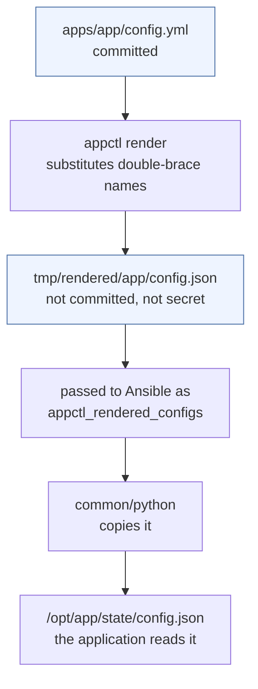

# Rendering

How an application's YAML configuration becomes the file the guest reads, and
why there is no per-application code.

## The path


## The file is partial, on purpose

**An application merges its own defaults into whatever it is given.** example-app
does this in `example-app/config/loader.py:178`:

```python
def merge_missing_defaults(existing, defaults):
    """Recursively add missing defaults without replacing configured values."""
```

It ships its own minimal `render-config.json` for its Render.com deployment,
which is the same idea: write what differs, let the application fill the rest.

Verified on a live guest — a two-key file boots the service:

```json
{ "gateway": { "port": 18790 },
  "providers": { "anthropic": { "apiKey": "${EXAMPLE_APP_API_KEY}" } } }
```

```
{"status": "ok", "process": "alive", "ready": true, "websocket": "running"}
```

So a rendered file with three keys is a normal, complete result. Not a degraded
one.

## Why there is no per-application script

There was one. `apps/example-app/files/example-app-configure.py` merged settings into
`config.json` on the guest every play. It was 112 lines, took nine positional
arguments, and reimplemented `merge_missing_defaults` in Python.

It was removed because it was a second implementation of behaviour the
application already had, shipped to every guest, free to drift from it — and
because it ran on the guest at install time for no benefit. The application
does the merge. That is strictly better, and the reason it was not obvious is
that the merge script predated the discovery that the application does it.

**Do not add one.** If an application needs something rendered that its own
loader cannot fill in, that belongs in the YAML.

## Substitutions

```yaml
# {{ name }}   substituted here, on the controller
port: "{{ api_port }}"
workspace: "{{ app_state_dir }}/workspace"

# ${NAME}      left exactly as written
apiKey: "${EXAMPLE_APP_API_KEY}"
```

The split is the safety property. A `${NAME}` reference is safe to commit; the
value is resolved on the guest, from a 0600 root-owned EnvironmentFile, at
startup. Unifying the two would resolve secrets here and write them to a file.

### Types

A placeholder occupying a whole value keeps the type it was declared with:

```yaml
# config.vars:  api_port: 8900
api: { port: "{{ api_port }}" }      →  8900        an integer
```

A placeholder inside a longer string is always a string, because concatenation
is what it means:

```yaml
workspace: "{{ app_state_dir }}/workspace"   →  "/opt/example-app/state/workspace"
```

Both were wrong at some point during development — flattening everything to
`str` rendered `"8900"`, which some applications reject.

### What is available

| Name | Source |
|---|---|
| `app_name` | the key in `applications:` |
| `app_home`, `app_dir`, `app_state_dir` | derived from `app_name` |
| anything in `config.vars` | declared by the application |

An undefined name is an error naming the file and the placeholder. It is not
left as literal text, because a config that renders differently on two runs is
worse than one that does not render.

The three paths mirror `common/python/defaults/main.yml`, which creates them.
That is a deliberate duplication: `appctl` has to know where the state directory
is to render a config into it, and `common/python` has to create it. Two places
that must agree is only safe if something makes them agree.

## Multiple files

`config.files` accepts a list. Later files merge over earlier ones, key by key:

```yaml
config:
  files:
    - apps/myapp/config.yml        # the base
    - apps/myapp/production.yml    # overrides
```

## Reviewing before deploying

`appctl render` writes the file and stops. Read it — it is exactly what the
guest will get:

```bash
appctl render
cat tmp/rendered/<app>/config.json
```

It is not committed and not secret, because it contains only `${NAME}`
references.

## Where the file lands

`app_config_target` in the role's `defaults/main.yml` decides:

```yaml
app_config_target: "{{ app_state_dir }}/config.json"
```

`common/python` copies it there as `app_user`, mode `0640`. It registers the
result as `app_rendered_config`, which an application can use to restart its
units only when the file actually changed:

```yaml
when: app_rendered_config.changed | default(false)
```