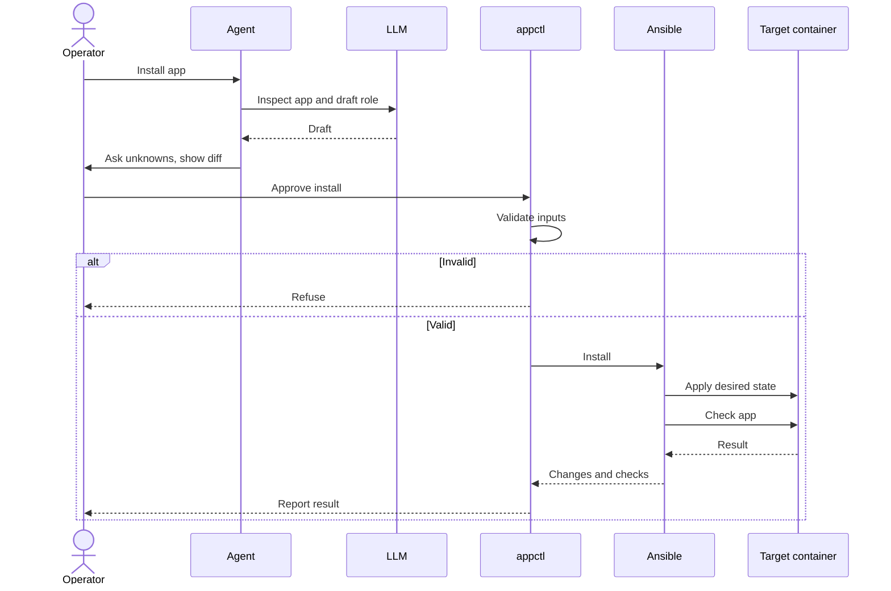

# Software Delivery Needs a Harness, Not a Better Prompt

*Let agents write the new parts of a deployment. Make the established rules executable so they do not have to guess them again.*

An agent can write an Ansible role faster than I can. It can inspect a repository, find an entry point, draft a service unit, and propose the tasks needed to install it. That is useful. But what should happen when it has finished writing?

A green playbook is not the answer. A process can be active while its UI returns 500. A port can be open while the application is bound to the wrong address. A deployment can succeed once and reinstall the same files on every subsequent run.

In [my earlier essay about engineer expectations](../engineer-expectations-before-and-after-genai/engineer-expectations-before-and-after-genai.md), I argued that engineers now need to turn unclear needs into reliable systems of work, not merely turn requirements into code. Software delivery is a good place to test that claim. If an agent writes deployment code, the surrounding system must decide what counts as valid and what evidence counts as done.

**The next step in agentic delivery is not to ask an LLM to make every operational decision. It is to build a harness around the work: a contract the agent can extend, deterministic tools that enforce decisions we have already made, and checks that can refuse a plausible but broken deployment.**

By Rodrigo A. Diaz Leven — <a href="https://www.linkedin.com/in/rodrigoleven/">LinkedIn</a> · <a href="https://github.com/bruj0">GitHub</a> · <a href="https://resume.bruj0.net/bruj0/rodrigo-leven">Resume</a>

## Table of contents

- [What an agent has to guess when you say “install it”](#what-an-agent-has-to-guess-when-you-say-install-it)
- [Make the next deployment less dependent on memory](#make-the-next-deployment-less-dependent-on-memory)
- [What belongs in the harness](#what-belongs-in-the-harness)
- [A delivery workflow with an agent in it](#a-delivery-workflow-with-an-agent-in-it)
- [The green deployment that returned 500](#the-green-deployment-that-returned-500)
- [What the earlier tools already taught us](#what-the-earlier-tools-already-taught-us)
- [Where judgment still belongs](#where-judgment-still-belongs)
- [About the author](#about-the-author)

## What an agent has to guess when you say “install it”

Ask an agent: “Install OmniRoute for me.” Without a shared delivery contract, it has to fill in the blanks as it goes:

1. **Inspect the app.** Is this a published release or a checkout that needs building? Does its native SQLite binding work on the target container's Node version?
2. **Choose a destination.** Which host, container or VM, ports, and service account should it use? Those are operator decisions, not facts in the npm package.
3. **Write and run the install.** It might choose `latest`, omit a required secret, or put a key in a command argument.
4. **Declare success.** A running unit and an open port do not prove that the database works or that anonymous callers cannot spend the operator's provider credentials.

A *harness* changes that sequence. DeployFlow's [example manifest](https://github.com/bruj0/deployflow/blob/main/app.example.yaml) includes a commented `omniroute-release` entry with the `proxmox_lxc` target and required secret names. Its [release role](https://github.com/bruj0/deployflow/blob/main/apps/omniroute-release/tasks/main.yml) pins and verifies the installed version, checks the native binding, and refuses anonymous inference requests that get through. The agent can draft changes to that role; the operator reviews them before `appctl install omniroute-release` runs. The [role guide](https://github.com/bruj0/deployflow/blob/main/apps/omniroute-release/README.md) records what the checks mean and requires a second install with `changed=0`.

**Do not spend model judgment on a decision you can encode and test.** Save it for the application's unfamiliar behavior.

## Make the next deployment less dependent on memory

When a team learns that a service must render a page after a build, the finding should not live only in an incident note or in the engineer who restarted it. When it learns that a build needs a pinned source, that rule should not depend on whether the next prompt mentions it. In DeployFlow, the [OmniRoute role](https://github.com/bruj0/deployflow/blob/main/apps/omniroute/tasks/main.yml) now keeps both lessons: it checks the build receipt before shipping and requests `/login` after starting. The next agent need not know the original incident to encounter those checks.

Agents make it cheaper to write the next deployment. That increases the value of a system that can say **no** with a reason and **yes** with evidence.

I want agents to spend their time on the new questions: what this application is, what it needs, where the uncertain parts are, and which checks would prove that it works. I want Python, Ansible, tests, and the operator to handle the decisions we can already state precisely. Not because an LLM is incapable of making a good guess, but because a good guess is the wrong standard for a decision we have already made.

The best result is not an agent that can describe a successful deployment. It is a delivery system that can distinguish one from a convincing failure — and gets better each time that distinction proves inadequate.

## What belongs in the harness

I built [DeployFlow](https://github.com/bruj0/deployflow) to explore this approach. It is a working application-delivery repository, not an autonomous deployment agent. The current implementation uses Python for a small `appctl` command and Ansible to install and verify applications in target Proxmox LXC containers. A [repository-local agent skill](https://github.com/bruj0/deployflow/blob/main/.agents/skills/deployflow-add-app/SKILL.md) explains how to add an application. An operator reviews the changes and authorizes the install.

Each part gets the work it is good at:

- **The [manifest](https://github.com/bruj0/deployflow/blob/main/app.example.yaml) records intent:** which source, target, configuration, and secret names the application needs. A reviewer can inspect those choices before a run.
- **The LLM agent handles the unknowns:** it investigates the app, asks the operator when a decision is missing, and drafts the manifest and app-specific role, following the [add-app skill](https://github.com/bruj0/deployflow/blob/main/.agents/skills/deployflow-add-app/SKILL.md). It can coordinate that writing and review, but does not authorize its own deployment.
- **[Python's `appctl`](https://github.com/bruj0/deployflow/tree/main/src/appctl) makes settled decisions deterministic:** it parses and validates the manifest, rejects unsupported targets and missing secrets, and runs the agreed build and install sequence. It does not guess what an unknown target means.
- **[Ansible roles](https://github.com/bruj0/deployflow/tree/main/apps) declare and check desired state:** they create or configure the target container, install files, start the service, and report changes. The application role checks whether this particular service actually works.
- **The operator owns the risk:** a person reviews the diff and decides whether to run the install against the chosen host.

In the [`omniroute-release` application](https://github.com/bruj0/deployflow/tree/main/apps/omniroute-release), that sequence means:

- **Agent and operator:** The agent investigates the release and proposes the manifest and role. The operator resolves unknowns, reviews the diff, and chooses whether to run the install.
- **`appctl` validates:** Python checks the manifest and required secrets. Only `proxmox_lxc` is implemented; the [target registry](https://github.com/bruj0/deployflow/blob/main/src/appctl/targets/registry.py) refuses `target.kind: docker_vm` before an install rather than silently treating it as an LXC.
- **Ansible applies and checks:** The [release role](https://github.com/bruj0/deployflow/blob/main/apps/omniroute-release/tasks/main.yml) pins the npm version, verifies what was installed, starts the service, and checks its behavior. A successful command alone is not its definition of done.
- **The result comes back:** `appctl` reports changes and checks to the operator. A repeat install should report `changed=0` while the checks still run.

The same boundary handles other sources without making the agent guess a single install recipe: the [source-built OmniRoute role](https://github.com/bruj0/deployflow/tree/main/apps/omniroute) requires a separate build and a commit receipt; the [builder role](https://github.com/bruj0/deployflow/tree/main/apps/builder) provides an environment rather than a service port. **The value is in making each decision explicit, then letting the right part of the workflow enforce it.**

## A delivery workflow with an agent in it

The workflow begins before any remote command runs. An operator asks for an application. The agent reads the [repository contract](https://github.com/bruj0/deployflow/blob/main/AGENTS.md) and [add-app skill](https://github.com/bruj0/deployflow/blob/main/.agents/skills/deployflow-add-app/SKILL.md), asks about any missing choices, writes a manifest entry and an application role, and shows the diff. It does not silently choose production credentials or treat a guessed port as a requirement.

The operator reviews the choice of source, target, configuration, and checks. Then `appctl` validates what it can before mutation: it rejects unsupported target kinds, missing required secrets, and source/build mismatches. The [Proxmox LXC target](https://github.com/bruj0/deployflow/blob/main/src/appctl/targets/proxmox_lxc.py) runs Ansible. The app role installs the artifact and tests the resulting service. A second install should report `changed=0` and run the checks again.

Consider the [Python `example-app` role](https://github.com/bruj0/deployflow/blob/main/apps/example-app/tasks/main.yml). It is easy to tell the agent to write a task that starts the unit. It is more useful to require its role to assert that the package imports, the unit is active, the process listens on the configured address and port, and an endpoint answers. If the endpoint fails, the play must fail. Those are distinct claims. One does not follow from the other.

`changed=0` is similarly narrow but valuable evidence. It says the same inputs did not require another install on a settled target container. It does not prove that no external dependency changed or that the app is healthy. That is why the application checks still run on the second pass. DeployFlow makes this visible in the [example-app guide](https://github.com/bruj0/deployflow/blob/main/apps/example-app/README.md): run `appctl install example-app` again and the report should say `0 changed` while the role still checks the package, unit, listener, and endpoint.

The agent can help write these checks. It cannot award itself a pass. Python validation and Ansible's observed results must make the final determination. That is what I mean by a *tested* agentic workflow: tests of the CLI contract, syntax checks for the playbook, a real install of worked examples, application-level postconditions, and a settled repeat run. It is not a claim that every new application or another person's infrastructure has already been tested.

This is also why a review of the generated diff remains necessary. A deterministic executor will reliably run a bad role. The harness reduces the number of decisions an agent must improvise; it does not remove the need to decide whether the role's application-specific checks are the right ones.

## The green deployment that returned 500

While installing the [source-built OmniRoute instance](https://github.com/bruj0/deployflow/tree/main/apps/omniroute), `appctl` [streamed Ansible's tasks](https://github.com/bruj0/deployflow/blob/main/src/appctl/install.py) as they ran and saved `log.txt`, `commands.txt`, `recap.txt`, and `errors.txt` under `tmp/runs/`. The run showed that the new tree had shipped, Ansible had made changes, and the play had ended green. The service was active, its port was open, and `/healthz` returned 200. Yet the UI returned 500. Those records made the contradiction visible; they did not diagnose the page failure on their own.

The application's log supplied the missing clue: React could not find modules in its Client Manifest. The running process had loaded the old server bundle, while Ansible had replaced its files on disk. Restarting the service restored the UI.

A manual restart would not prevent the next failure. I updated [the role](https://github.com/bruj0/deployflow/blob/main/apps/omniroute/tasks/main.yml) to restart when the shipped bundle is newer than the process, then request `/login`. A 500 now fails the play even if `/healthz` returns 200. I also excluded Next.js's runtime route cache in the [role defaults](https://github.com/bruj0/deployflow/blob/main/apps/omniroute/defaults/main.yml): rsync had been deleting that target-container cache, making every run look changed. Restarting on *any* transfer change would have caused needless restarts.

After a controlled stale-bundle test, `appctl` showed the restart and the subsequent installs reported `0 changed` while checks still ran. **The streamed run showed what Ansible did; the app log showed what it missed; the new page check made that lesson part of the next run.**

## What the earlier tools already taught us

DeployFlow does not invent agent-assisted operations. That claim would ignore a useful body of prior work.

The [kubectl-ai project](https://github.com/GoogleCloudPlatform/kubectl-ai) shows an LLM helping users choose and call Kubernetes tools while Kubernetes performs the changes. The [AWS deploy skill](https://github.com/awslabs/agent-plugins/blob/main/plugins/deploy-on-aws/skills/deploy/SKILL.md) shows an agent inspecting an application, proposing cloud infrastructure, generating deployment code, and asking for confirmation. [Appaloft](https://github.com/nichenqin/appaloft) and [DaoFlow](https://github.com/DaoFlow-dev/DaoFlow) describe agent-facing delivery workflows for server or container targets. [Ansible's AAP MCP service](https://github.com/ansible/aap-mcp-server) exposes existing automation to an external agent; that interface is not itself an LLM. [Flux Operator's MCP tools](https://github.com/controlplaneio-fluxcd/flux-operator) likewise let a client ask for operations while a controller reconciles state.

These examples differ in targets and design. Their common lesson is more important than a feature checklist: an agent's ability to *request* a deployment is separate from the system's ability to *apply and verify* it. An MCP server is a tool interface, not proof of autonomous reasoning. An Ansible role is automation, not an agent. Human confirmation in a skill is a workflow rule, not an enforced approval protocol.

My narrower claim for DeployFlow is that it puts a reviewable application contract beside a tested Proxmox LXC and Ansible implementation. It couples the agent's drafting work to refusals and observable postconditions: a wrong source receipt, missing secret, unsupported target, failed endpoint, or repeat install that churns should be visible.

 For example, the [source-built OmniRoute role](https://github.com/bruj0/deployflow/blob/main/apps/omniroute/tasks/main.yml) reads a build receipt and refuses to ship it if the recorded commit differs from the checkout's requested commit. The agent can propose a new role; that comparison still runs when the operator installs it. Some prior projects also offer contracts, verification, or target abstractions; the point is to make those properties real in this deployment path, not to claim they have never existed before.

That distinction protects an important question: what can a new user actually run? A successful deployment on my own host is evidence about that host. It is not a clean-clone acceptance test on a second Proxmox installation.

## Where judgment still belongs

Codifying known decisions does not settle every deployment decision. Someone still has to decide which application behavior matters, which failure should stop a release, how to handle data migration, what an acceptable outage is, and whether a credential has enough scope. Those choices depend on the service and its users.

Nor does an agent-facing skill make remote mutation safe by itself. A future interface that lets agents apply changes directly would need separate read, plan, and apply permissions; approval tied to the exact target, manifest, and artifact; scoped credentials; redacted audit evidence; and a tested account of retries and rollback. DeployFlow does not claim to provide that approval system today. The operator still controls when `appctl install` runs. In practice, an agent can follow the [add-app skill](https://github.com/bruj0/deployflow/blob/main/.agents/skills/deployflow-add-app/SKILL.md) to prepare a new role and show its diff; the operator decides whether to run the install against the configured Proxmox host. A skill's request for approval is not a technical substitute for that decision.

The harness can also fail. A postcondition can check the wrong endpoint. A lockfile can pin the wrong artifact. A health check can miss a broken UI. The answer is not to give the model wider authority; it is to improve the contract and the test when evidence exposes the miss. In the OmniRoute case, “process active” and “healthz 200” were true statements. They were insufficient statements.

That leads to a practical rule for teams building their own delivery workflows:

| If the question is... | Put the answer... |
|---|---|
| What does this particular application need? | In a reviewed manifest and app-specific role |
| Which targets and input shapes are supported? | In strict validation code |
| How do we repeat the install? | In a deterministic executor such as Ansible |
| Did this service actually work? | In observable application postconditions |
| May this change reach this host now? | With an accountable human or a tested approval mechanism |

The table is not a demand for five layers of ceremony around a trivial script. It is a way to keep one kind of decision from being quietly delegated to the wrong component. Review depth should follow the risk of the deployment.

---

## About the author

**Rodrigo A. Diaz Leven** is a platform engineering lead focused on AI-assisted engineering, evaluation, and developer tooling.

If this essay sparked a question, disagreement, or an example from your own team, he would like to hear it:

- LinkedIn: <https://www.linkedin.com/in/rodrigoleven/>
- GitHub: <https://github.com/bruj0>
- Resume: <https://resume.bruj0.net/bruj0/rodrigo-leven>
